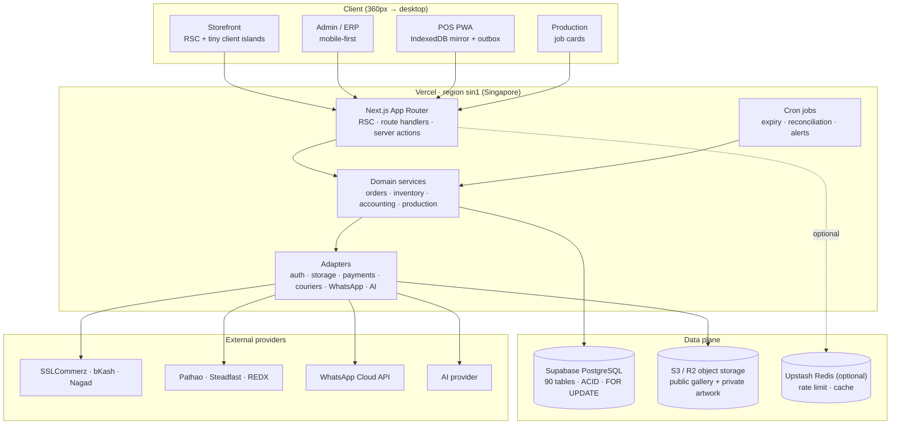
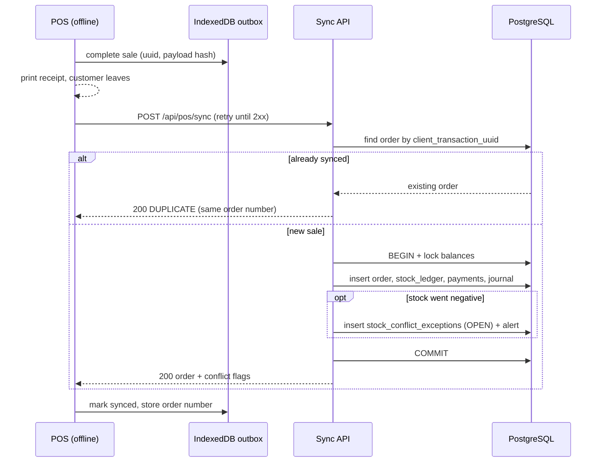
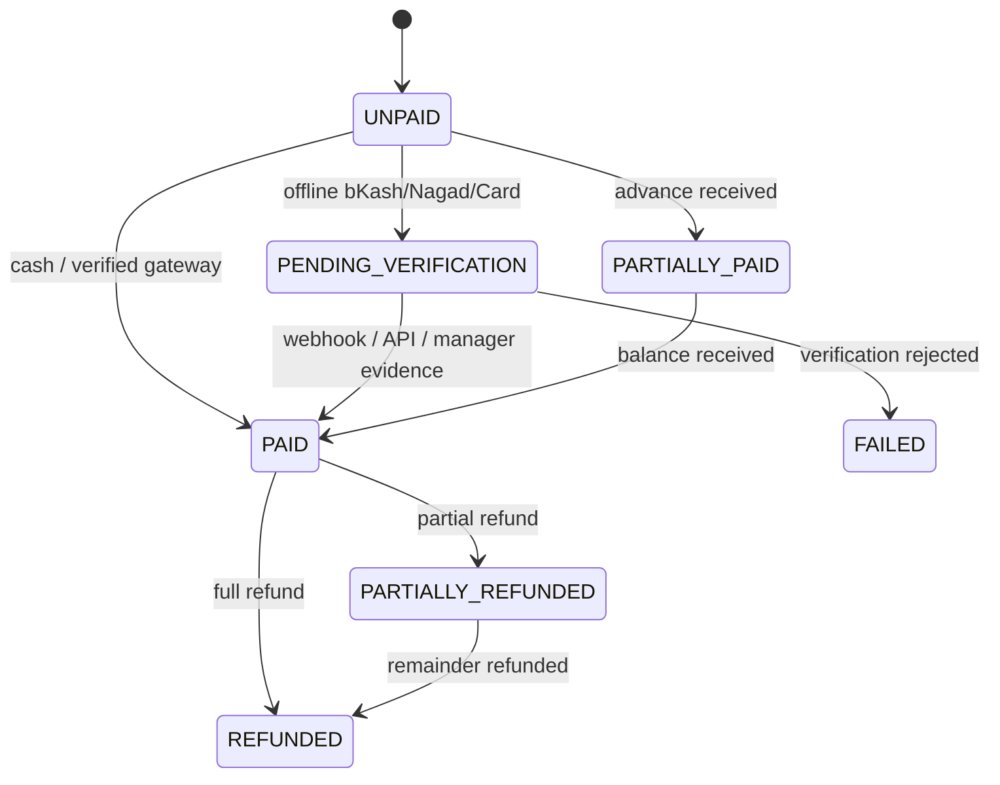

# bgd26.com — System Architecture

**Phase 1 · Architecture & Schema gate**
Version 1.0 · Scope: e-commerce + physical POS + offline sync + multi-warehouse
inventory + custom engraving production + CRM/loyalty + double-entry accounting +
official WhatsApp + guardrailed AI + dropshipping.

> **What this document is:** the engineering contract for the whole build. Every
> later phase must conform to it. Nothing here is a mockup: the schema in
> `prisma/schema.prisma` is the real database for the product.
>
> **What is *not* built yet:** application routes, migrations, seeds and UI.
> Phase 1 stops at architecture + schema, exactly as requested.

---

## 1. The product in one paragraph

bgd26.com is one business, one PostgreSQL database and one set of server-side
rules. A customer can buy on the web or in a shop; both channels write to the
same `orders` table. Every sale, purchase, refund and expense posts a balanced
double-entry journal automatically. Stock lives in warehouses, not in a single
"quantity" column, and every movement is an immutable ledger row. Custom
engraving is a production job with a customer design-approval gate. POS keeps
selling when the internet dies and syncs later without losing a physical sale.
WhatsApp and AI sit on top, read-only or draft-only. Dropshipping is a
fulfilment type on the same order, not a second system.

---

## 2. System topology



**One deployment region.** App in Singapore (`sin1`), database in Singapore or
Mumbai. Bangladesh users get the lowest realistic round-trip; the storefront is
CDN-cached so most page loads never touch the origin.

---

## 3. Stack and module boundaries

| Layer | Choice | Why |
| --- | --- | --- |
| Framework | Next.js (App Router) + TypeScript strict | RSC keeps client JS tiny; one codebase for storefront + ERP + API |
| Styling | Tailwind CSS, no UI kit, no animation library | Full control of the mobile budget; no 200KB component bundle |
| Database | PostgreSQL 15+ (Supabase) | Transactions, row locks, partial indexes, `numeric`, mature |
| ORM | Prisma | Typed queries, explicit `select`, migrations |
| Validation | Zod at every boundary | Never trust client totals, prices or quantities |
| Money math | `decimal.js` (never JS floats) | 0.1 + 0.2 must never decide a ledger |
| Auth | Supabase Auth behind `AuthAdapter` | Swappable; staff sessions verified server-side |
| Media | S3-compatible (R2/S3) | Original bytes, checksums, private bucket, signed URLs |
| Tests | Vitest + Playwright + ephemeral Postgres | Business rules are tested, not eyeballed |
| Deploy | GitHub Actions + Vercel | Preview per PR, tagged production releases |

### Planned directory layout (created in Phase 2+)

```
src/
  app/
    (storefront)/            # public, cached, RSC
    (admin)/                 # staff ERP, auth-gated
    pos/                     # POS PWA shell
    production/              # job cards
    api/                     # webhooks, sync, health
  components/
    ui/                      # small accessible primitives
    storefront/
    admin/
    pos/
  lib/
    adapters/                # auth, storage, payments, couriers, whatsapp, ai
    db/                      # prisma client, select DTOs
    domain/                  # orders, inventory, accounting, production, loyalty
    security/                # rbac, session, rate-limit, crypto
    validation/              # zod schemas shared by UI + API
    i18n/                    # bn/en dictionaries
  styles/
prisma/
  schema.prisma
  migrations/
  seed/
docs/
scripts/                     # schema check, ER generation, smoke tests
```

**Rule:** route handlers and server actions are thin. They validate input,
authorise, then call one domain service inside a transaction. Business rules
never live in React components, never in SQL triggers alone, and never in an
adapter.

---

## 4. Sub-second speed architecture

### 4.1 Budgets we will hold ourselves to

| Metric | Budget | How measured |
| --- | --- | --- |
| TTFB, cached page, BD 4G | ≤ 200 ms | Vercel analytics + WebPageTest Dhaka |
| Storefront LCP, p75 4G | ≤ 1.0 s | Lighthouse mobile / field data |
| Storefront LCP, throttled 3G, warm cache | ≤ 2.0 s | Lighthouse "Slow 4G" + 3G profile |
| HTML per page (gzip) | ≤ 60 KB | build report |
| Route JS (gzip) | ≤ 90 KB | `next build` output |
| POS barcode/SKU search p95 | ≤ 50 ms | on-device benchmark |
| POS cart recalculation | ≤ 16 ms | one frame |
| API read p95 | ≤ 150 ms | server timing |
| DB query p95 | ≤ 25 ms | `pg_stat_statements` |
| Horizontal scroll at 360 px | zero pages | Playwright assertion |

**Honesty note on "under 1 second on 3G":** no origin can beat the physics of a
cold 3G round-trip. What we *can* guarantee: (a) the cached HTML shell arrives
in one round-trip, (b) the page is usable before images finish, (c) the second
visit is served from the CDN edge in well under a second. First-ever 3G visits
target ≤ 2 s, not 1 s. This is stated up front so the target is measurable
rather than marketing.

### 4.2 Rendering strategy

- **Server Components by default.** Catalog, product pages, order lists,
  reports and dashboards are RSC. `'use client'` is limited to: cart drawer,
  POS terminal, barcode listener, design uploader, manager-PIN modal, language
  toggle, filters that need instant feedback.
- **No client-side data fetching for first paint.** No React Query on the
  storefront; the server already has the data.
- **Streaming with Suspense** for slow secondary blocks (recommendations,
  production timeline) so the main content is not blocked.
- **Cache layers:**
  1. React `cache()` for per-request deduplication (same product fetched in
     layout + page = one query).
  2. `unstable_cache` with explicit tags (`product:{id}`, `catalog:list`,
     `zone:{id}`) for catalog and CMS-like data.
  3. `revalidateTag` on writes (product update, price change, stock threshold).
  4. ISR for product and category pages (`revalidate = 300`) with on-demand
     invalidation.
  5. CDN edge caching for public GETs; `Cache-Control: s-maxage=60,
     stale-while-revalidate=300` for category pages.
  6. **Stock is never cached as a number on the storefront.** The product page
     shows "In stock / Low stock / Pre-order" from a short (≤15 s) cache, and
     final availability is revalidated in the order transaction. This prevents
     overselling while keeping pages static.
- **Keyset pagination** everywhere (orders, ledger, customers), never `OFFSET`
  on large tables.
- **Explicit Prisma `select`** in every query. No `include: { everything }`.
  Cost fields are never selected for cashier or storefront DTOs.
- **Denormalised list fields** (`orders.hasDropshipItems`,
  `orders.requiresProduction`, `customers.loyaltyPointsBalance`) avoid joins on
  hot list screens.
- **Fonts:** `next/font` with Hind Siliguri (Bangla) + Inter (Latin), subset,
  `display: swap`, preload only the two weights actually used.
- **Icons:** inline SVG paths; no icon package.
- **Images:** originals via `` / `next/image` with `unoptimized` and
  explicit dimensions to prevent layout shift (zero-transform rule, §10).

### 4.3 POS speed

The POS is a PWA. On shift open it downloads a compact catalog snapshot into
**IndexedDB**:

```
{ variantId, sku, barcode, name, price, taxRate, avcoCost, unit, bundle }
```

- Barcode scan → in-memory index (Map keyed by barcode/SKU) → **< 5 ms**, not
  50 ms. IndexedDB is the durable mirror; the hot index is in memory.
- Cart totals, discounts, VAT and change are computed locally, so the UI never
  waits for the network.
- The receipt is printable/queued offline. Network is needed only for sync and
  card/bKash verification.

### 4.4 Database performance

- Composite indexes for every hot path (see schema): mobile, SKU, barcode,
  order status + date, warehouse + available qty, ledger reference.
- `numeric` for money; no floating point.
- Partial unique indexes for "one default", "one open shift" (Phase 2 SQL).
- No N+1: list endpoints fetch children with one `IN (...)` query.
- Slow-query budget enforced in CI with seeded 100k-order dataset.

---

## 5. Mobile-first UI architecture

### 5.1 Breakpoints and layout rules

| Width | Layout |
| --- | --- |
| 360–430 px | Single column, thumb zone, sticky bottom action bar, bottom tab nav ≤ 5 items |
| 431–767 px | Single column, wider cards, two-column form pairs only when labels stay readable |
| 768–1023 px | Two-column admin, sidebar collapsible, tables allowed |
| ≥ 1024 px | Full ERP layout, data tables, split views |

Non-negotiables:

- Minimum **48 × 48 px** tap targets, 8 px spacing between destructive and safe
  actions.
- **No horizontal scrolling.** Tables become stacked cards below 768 px; each
  card shows label/value pairs, not a squeezed grid.
- **Sticky bottom bars** on mobile: `Add to cart`, `Confirm order`,
  `Complete sale`, `Save & next`. Respect `env(safe-area-inset-bottom)`.
- **One primary action per screen.** Secondary actions go into a "More" sheet.
- **No modals for core flows.** The manager-PIN override is the only blocking
  modal, because it is a security checkpoint.
- Inputs use `inputmode="numeric"` for phone/PIN, `autocomplete` for address,
  and 16px font to prevent iOS zoom.
- Every page works one-handed; primary buttons sit in the lower third.

### 5.2 The 3-tap POS

One screen, three zones:

1. **Scan / search bar** (auto-focus, barcode keyboard listener).
2. **Cart list** with line totals, quantity stepper, discount.
3. **Bottom bar:** `Mobile number` → `Cash / bKash / Card` → `Complete`.

Flow: scan (tap 1) → enter mobile or choose `Walk-in` (tap 2) → tap payment
method (tap 3) → done. Mobile entry is a 11-digit numeric keypad; `01…`,
`8801…` and `+8801…` are normalised on blur. Cash shows a change calculator.
Digital payments offline are saved as `PENDING_VERIFICATION`, never `PAID`.

### 5.3 Single-page checkout

Fields on one page, in this order: name → mobile → division → district →
upazila → address → payment method → place order. Division/district/upazila are
dependent selects with local data (no API round-trip). The coupon and loyalty
blocks are collapsed by default. The order summary is a sticky card on desktop
and a collapsible bar on mobile.

### 5.4 Bilingual UI

- Default `bn`; toggle in the header and in POS settings; stored in a cookie
  and on `users.locale` / `customers` preference.
- **No i18n library.** Two typed dictionaries (`bn.ts`, `en.ts`) and a
  `t(key)` helper; missing keys fail the build.
- Money uses `Intl.NumberFormat('bn-BD')` in Bangla mode, `en-BD` in English,
  always with the ৳ symbol.
- Never show accounting jargon to cashiers. Examples:

| Internal concept | Staff label (bn) | Staff label (en) |
| --- | --- | --- |
| AVCO recalculation | স্টক মূল্য আপডেট হয়েছে | Stock value updated |
| Journal entry posted | হিসাবে যোগ হয়েছে | Recorded in accounts |
| Stock conflict exception | স্টক মিলছে না — ম্যানেজার দেখুন | Stock mismatch — manager review |
| Production handover | ডেলিভারিতে পাঠানো হয়েছে | Handed to dispatch |

Bengali text is written in everyday language, not literal translation of
English accounting terms.

### 5.5 Accessibility

- Semantic landmarks, visible focus rings, 4.5:1 contrast.
- Every icon button has an `aria-label` in the active language.
- Live regions for cart totals and sync status.
- `prefers-reduced-motion` respected; no motion libraries.
- Keyboard support for POS (F2 scan, F4 payment, Esc clear) for desktop users.

---

## 6. Unified data model rules

1. **One customer identity.** `customers.mobile_normalized` is unique and stores
   strict `+8801XXXXXXXXX`. All lookups use this column. Raw input is kept in
   `mobileRaw` for support, and every change writes `customer_mobile_history`.
2. **One order system.** `orders.channel = ONLINE | POS`; a POS sale is an
   order, not a separate receipt table. This is what makes one revenue number,
   one loyalty balance and one journal possible.
3. **One inventory engine.** `inventory_balances` is a per-variant,
   per-warehouse projection. `stock_ledger` is the immutable truth. Any
   disagreement is a bug, detected by `inventory_reconciliation_runs`.
4. **One accounting engine.** Every financial event produces one
   `journal_entries` row and ≥ 2 `journal_entry_lines` rows with
   `SUM(debit) = SUM(credit)`.
5. **One catalog.** Storefront and POS read the same `products` /
   `product_variants`. There is no "POS-only price" column; channel pricing is
   a promotion, not a duplicate product.
6. **One media gallery.** `media_assets` stores original bytes + SHA-256;
   `product_media` attaches them. Archiving a product never deletes media.
7. **One audit trail.** `audit_logs` is append-only and records actor, action,
   entity, before/after, reason, IP and request id.
8. **One permission system.** Server-side RBAC. Hiding a button is UX, never
   security.
9. **One engagement layer.** Reviews, wishlists, newsletter and CMS pages
   attach to the same customer/product identity. There is no second storefront
   database, and no duplicated product data for content pages.

See `docs/ER_DIAGRAM.md` for the complete 90-table map.

---

## 7. Adapter pattern (ports & adapters)

All external services sit behind server-only TypeScript interfaces in
`src/lib/adapters/*`. Business logic depends on the interface, never on a
vendor SDK. This is what makes Supabase/AWS/bKash replaceable without touching
order or ledger code.

```ts
// src/lib/adapters/auth.ts
export interface AuthAdapter {
  signInWithPassword(input: { email: string; password: string }): Promise<AuthSession>;
  verifySession(token: string): Promise<AuthSession | null>;
  signOut(sessionId: string): Promise<void>;
  createUser(input: { email: string; password: string; fullName: string }): Promise<{ userId: string }>;
  requireMfa?(userId: string): Promise<boolean>;
}

// src/lib/adapters/storage.ts
export interface StorageAdapter {
  createPresignedUpload(input: {
    bucket: 'gallery' | 'customization' | 'documents';
    key: string;
    contentType: string;
    maxBytes: number;
    expiresInSeconds: number;
  }): Promise<{ uploadUrl: string; method: 'PUT' }>;
  /** Streams the object, verifies magic bytes, returns SHA-256. Never rewrites bytes. */
  inspectOriginal(input: { bucket: string; key: string }): Promise<{
    byteSize: number; mimeType: string; sha256: string;
  }>;
  createSignedDownload(input: { bucket: string; key: string; expiresInSeconds: number }): Promise<string>;
  deleteObject(input: { bucket: string; key: string }): Promise<void>;
}

// src/lib/adapters/payments.ts
export interface PaymentAdapter {
  readonly provider: 'SSLCOMMERZ' | 'BKASH' | 'NAGAD';
  createPayment(input: {
    paymentRequestId: string; amount: string; currency: 'BDT';
    customer: { name: string; mobile: string; email?: string };
    returnUrl: string; idempotencyKey: string;
  }): Promise<{ redirectUrl: string; providerReference: string }>;
  verifyWebhook(input: { headers: Record<string, string>; rawBody: string }): Promise<{
    eventId: string; providerTxnId: string; status: 'SUCCESS' | 'FAILED' | 'PENDING'; amount: string;
  }>;
  queryTransaction(providerTxnId: string): Promise<{
    status: 'SUCCESS' | 'FAILED' | 'PENDING'; amount: string; raw: unknown;
  }>;
  refund(input: { providerTxnId: string; amount: string; reason: string; idempotencyKey: string }): Promise<{
    providerRefundId: string; status: 'SUCCESS' | 'PENDING' | 'FAILED';
  }>;
}

// src/lib/adapters/couriers.ts
export interface CourierAdapter {
  readonly provider: 'PATHAO' | 'STEADFAST' | 'REDX';
  createShipment(input: {
    orderNumber: string; recipientName: string; recipientMobile: string;
    address: string; district: string; codAmount: string; weightGrams: number;
    idempotencyKey: string;
  }): Promise<{ consignmentId: string; trackingNumber: string; labelUrl?: string }>;
  cancelShipment(consignmentId: string): Promise<void>;
  parseTrackingWebhook(input: { headers: Record<string, string>; rawBody: string }): Promise<Array<{
    trackingNumber: string; status: string; message?: string; occurredAt: Date;
  }>>;
}

// src/lib/adapters/whatsapp.ts
export interface WhatsAppAdapter {
  sendTemplate(input: {
    to: string; templateName: string; language: string; variables: string[]; idempotencyKey: string;
  }): Promise<{ waMessageId: string }>;
  sendText(input: { to: string; body: string; idempotencyKey: string }): Promise<{ waMessageId: string }>;
  verifyWebhookSignature(input: { rawBody: string; signatureHeader: string }): boolean;
}

// src/lib/adapters/ai.ts
export interface AiProvider {
  complete(input: {
    system: string; messages: Array<{ role: 'user' | 'assistant'; content: string }>;
    tools: AiToolDefinition[]; locale: string;
  }): Promise<AiToolCallResult>;
}
```

**Adapter rules**

- Adapters are server-only. No adapter secret reaches the browser.
- Adapters translate formats; they do not decide business outcomes.
- Every adapter call that can be retried accepts an `idempotencyKey`.
- Every webhook is verified before parsing, and raw body is used for HMAC.
- A provider outage degrades one feature; it must never corrupt an order or a
  ledger.

---

## 8. Security architecture

### 8.1 Authentication and sessions

- Supabase Auth behind `AuthAdapter`; staff and customers use the same identity
  store but different role assignments. The adapter is swappable: `local`
  verifies `users.passwordHash` (scrypt) for development and offline-capable
  deployments, `supabase` delegates the password to Supabase Auth and links the
  provider user through `users.supabaseUserId`. `AUTH_PROVIDER` selects it.
- The provider is the credential store, not the session store. The application
  issues its own HMAC-SHA256 signed token in an `HttpOnly`, `Secure`,
  `SameSite=Lax` cookie bound to `users.id`. Server components and route
  handlers verify the signature **and** re-read `users.status` / `deletedAt` on
  every request, so disabling an account takes effect immediately.
- Guards live in pages and server actions (`requireStaff`,
  `requirePermission`), not in a proxy: Next renders a layout and its page in
  parallel, so a redirect thrown from a layout would abort a page query.
- Owner/admin accounts require TOTP MFA for production.
- Manager actions (discount > 5 %, `WALK_IN_CASH`, manual payment verification,
  stock conflict resolution, refund approval) require a **manager PIN**:
  - 4–6 digits, hashed with Argon2id + `MANAGER_PIN_PEPPER`,
  - 5 failed attempts → 15-minute lock,
  - every success and failure writes `audit_logs`.
- No "remember me" on shared POS devices.

### 8.2 RBAC

Permissions are `resource.action` codes stored in `permissions`, grouped by
roles. Suggested seed roles:

| Role | Typical scope |
| --- | --- |
| OWNER | everything, including period lock and account mapping |
| ADMIN | catalog, staff, settings; no period unlock |
| MANAGER | overrides, refunds, stock conflicts, shift close |
| CASHIER | POS sale, shift open/close, customer lookup; no cost prices |
| PRODUCTION | job cards, design upload, status changes; no prices |
| ACCOUNTANT | journals, expenses, statements; no stock writes |
| SUPPORT | orders read, WhatsApp inbox, customer notes |
| DROPSHIP_COORDINATOR | supplier POs, dropship shipments, tracking |

Permission checks happen in the domain service, not only in the route. Example
codes: `pos.sale.create`, `order.discount.override`,
`inventory.adjustment.post`, `accounting.journal.post`,
`accounting.period.lock`, `production.design.approve`,
`payment.verify.manual`, `ai.use`, `report.financial.read`.

### 8.3 Input, output and money safety

- Zod at every mutation boundary: types, lengths, enums, ranges, phone format.
- Server recomputes all totals from catalog + rules. Client totals are for
  display only and are compared before commit.
- Cost prices are stripped by DTO serializers for cashier/warehouse roles; a
  generic `include` can never leak them.
- Discount guard: server computes discount percentage per line and per order.
  > 5 % requires manager PIN + reason + audit log. Coupons are not a loophole:
  a coupon above the cap needs the same override.
- SQL is parameterised by Prisma. Raw SQL (locks, reports) uses tagged
  parameters only.
- Output escaping is React's default; any `dangerouslySetInnerHTML` is
  forbidden outside sanitised WhatsApp template previews.

### 8.4 Webhooks and files

- Payment, courier and WhatsApp webhooks: verify HMAC/signature against the
  **raw** body, reject stale timestamps, enforce idempotency with unique
  provider IDs, log every attempt in the relevant audit/log table.
- Uploads: presigned PUT, allow-listed MIME + magic bytes, max 20 MB, SHA-256
  computed server-side, randomised immutable keys.
- Customer artwork lives in a private bucket. Access is only through a
  short-lived signed URL (5 min) issued to an authorised staff session. URLs
  are never stored in `media_assets` as permanent links.
- Public gallery keys are random UUIDs; bucket listing is disabled.
- Security headers: CSP with nonce, HSTS, `X-Content-Type-Options`,
  `Referrer-Policy`, `Permissions-Policy`, frame-ancestors none.
- Rate limits on login, OTP, payment initiation, AI, webhook replay and POS
  sync (per device).
- Secrets: only `.env.local` / platform env. `.gitignore` blocks `.env*`
  before the first commit. No logging of tokens, full phone numbers or PINs.
  PII in logs is masked (`+8801******789`).

### 8.5 Data protection

- Customer mobile is PII: mask in lists for non-support roles, never put it in
  URLs or analytics.
- `audit_logs` retains before/after snapshots only for changed fields, not whole
  objects.
- Soft delete only for products, variants, customers, addresses; financial and
  stock history is never deleted.
- Backups: Supabase PITR in production; restore drill before launch.

---

## 9. Inventory engine and AVCO

### 9.1 Stock states

`inventory_balances` holds one row per variant per warehouse:

| Column | Meaning |
| --- | --- |
| `physical_qty` | units physically in the warehouse |
| `reserved_qty` | promised to confirmed orders, not yet dispatched |
| `available_qty` | sellable now |
| `damaged_qty` | unsellable, awaiting write-off/return |
| `quarantined_qty` | held for QC/inspection |
| `in_production_qty` | in the engraving/production area |
| `avco_unit_cost` | weighted average cost, 4 dp |

**Invariant:** `available = physical − reserved − damaged − quarantined −
in_production`. The service writes all six fields together inside one
transaction.

**Lifecycle of a stocked unit**

```
GRN (+physical, recalc AVCO)
  → order CONFIRMED (reserved+, available−)
  → production start (reserved−, in_production+)
  → handover/ship (physical−, in_production−, stock_ledger SALE)
  → delivered (fulfillment = FULFILLED)

not custom: CONFIRMED (reserved+) → ship (physical−, reserved−, ledger SALE)
return:    restock (physical+, AVCO re-blend at original cost)
```

### 9.2 AVCO formula

On every **inbound** movement (GRN, positive adjustment, sale return,
transfer-in, production return):

```
new_qty   = old_qty + in_qty
new_value = old_qty × old_avco + in_qty × landed_unit_cost
new_avco  = round(new_value / new_qty, 4)     // half-up, decimal.js
```

`landed_unit_cost` = supplier unit cost + allocated inbound freight/duty for
that receipt. **Outbound movements do not change AVCO**; they consume at the
current AVCO and write `unit_cost` on the ledger row and
`order_items.cost_price_snapshot`.

Rules:

- **Transfer** out at source AVCO, in at the same AVCO. The transfer fee is an
  expense (`Transfer Expense`), never capitalised into stock value.
- **Sale return** re-enters at the original sale cost snapshot
  (`order_items.cost_price_snapshot`); if missing, current warehouse AVCO.
- **Purchase return** leaves at the GRN unit cost, and AVCO is recalculated on
  the reduced quantity.
- **Negative stock** (offline conflict): keep the last known AVCO. Never divide
  by a negative quantity. The variance is flagged for manager resolution.
- Rounding: unit cost 4 dp, ledger value 2 dp, journal 2 dp. Any residual
  rounding difference goes to `Inventory Rounding` (system account) so the
  ledger stays balanced.

### 9.3 Worked example

| Step | Qty | Unit cost | Total value | AVCO |
| --- | --- | --- | --- | --- |
| Opening | 10 | 100.0000 | 1,000.00 | 100.0000 |
| GRN 10 @ 120 + freight 100 → landed 1,210 | 20 | — | 2,210.00 | **110.5000** |
| Sell 5 (COGS 552.50) | 15 | 110.5000 | 1,657.50 | 110.5000 |
| Return 2 at original 110.50 | 17 | 110.5000 | 1,878.50 | 110.5000 |
| GRN 5 @ 90 + freight 50 = 500 | 22 | — | 2,378.50 | **108.1136** |
| Transfer 4 to Warehouse B | 18 | 108.1136 | 1,946.05 | 108.1136 |

Warehouse B receives 4 @ 108.1136 and blends with **its own** AVCO.

### 9.4 Concurrency

Every stock mutation runs in a transaction and locks rows in a deterministic
order (sort by `variantId`, then `warehouseId`) to avoid deadlocks:

```sql
BEGIN;
SELECT id, physical_qty, reserved_qty, available_qty, avco_unit_cost
FROM inventory_balances
WHERE warehouse_id = $1 AND variant_id = ANY($2::text[])
ORDER BY variant_id
FOR UPDATE;
-- validate, write balances, stock_ledger, reservation, journal
COMMIT;
```

Online orders and live POS **reject** if `available < requested`. Offline POS
sync is the only path allowed to go negative (§11.4). A `SERIALIZABLE` retry
policy is not used globally; `READ COMMITTED` + row locks is faster and
sufficient. Deadlock/serialization errors are retried up to 3 times with
jitter.

### 9.5 Bundles

Availability is dynamic and per warehouse:

```
bundle_available = MIN over components FLOOR(component.available / required_qty)
```

- Selling a bundle writes reservations for each component; there is no
  "bundle stock" row.
- A bundle cannot contain itself, directly or transitively. The service runs a
  recursive check before save, and the DB blocks `bundle_variant_id =
  component_variant_id`.
- Returns: complete bundle only in Phase 1. `refunds.isBundleReturn = true`,
  every `refund_items.bundleComplete = true`; partial component return is
  rejected.

### 9.6 Non-stock and services

`NON_STOCK` / `SERVICE` variants bypass `inventory_balances`,
`stock_reservations` and `stock_ledger`. They still create `order_items`,
payments, revenue, VAT and journal entries. Their cost snapshot is taken from
`product_variants.cost_price` at sale time (often 0 for a service).

### 9.7 Physical count

`inventory_reconciliation_runs` snapshots expected vs counted. Approved
differences post a `stock_adjustments` row of type `RECOUNT` and a journal:
**Dr Inventory Shrinkage / Cr Inventory** (or reverse for surplus).

---

## 10. Zero-transform media pipeline

The rule: **the gallery serves the exact bytes the photographer uploaded.**

```
Staff browser ──presigned PUT──▶ S3/R2 (gallery/, immutable key)
        │                                  │
        └──finalize(key, declaredMime)────▶ server
                                           ├─ stream object, compute SHA-256
                                           ├─ verify magic bytes == declared MIME
                                           ├─ HEAD size, reject > 20 MB
                                           └─ INSERT media_assets (checksum, bytes, mime)
```

- Allowed: WebP, AVIF, JPEG, PNG (and PDF for documents only).
- **No resize, recompress, crop, strip-EXIF or format conversion — ever.**
  Rendering uses `next/image` with `unoptimized` or a plain ``, with
  explicit `width`/`height` from `media_assets` to avoid layout shift.
- Storage keys are random and immutable:
  `gallery/2026/11/{uuid}.{ext}`. Overwriting is not allowed.
- Cache headers on public originals: `Cache-Control: public, max-age=31536000,
  immutable`. CDN handles delivery.
- `media_assets.sha256_checksum` is indexed for duplicate detection and
  integrity audits.
- **Customer artwork** goes to the private `customization` bucket:
  `customization/{orderId}/{uuid}.{ext}`. Never public. Staff UI requests a
  5-minute signed URL; every issue is permission-checked and audit-logged.
- **Deleting/archiving a product never deletes media.** Rows are unlinked from
  `product_media`; the asset remains until a separate, audited cleanup job
  proves zero references and the retention period has passed.
- Upload validation is defence in depth: MIME header + magic bytes + extension
  + size, and the object is re-read server-side. SVG is rejected (XSS risk).

---

## 11. Offline POS sync and conflict resolution

### 11.1 What lives on the device

| Store | Content |
| --- | --- |
| IndexedDB `catalog` | variant id, SKU, barcode, name, price, tax rate, cached cost, bundle map, version |
| IndexedDB `customers` | recent customers by normalized mobile (optional cache) |
| IndexedDB `outbox` | one record per completed sale, with `clientTransactionUuid` and payload hash |
| IndexedDB `meta` | shift id, device id, catalog version, last sync cursor |

The catalog snapshot is versioned. The POS refuses to start a shift on a
snapshot older than 24 hours and warns after 6 hours (prices may have changed).

### 11.2 Local sale flow

1. Cashier scans; lookup is in-memory (Map), fallback IndexedDB, never network.
2. Cart totals calculate locally with the same decimal rules as the server.
3. `Complete` writes the sale to the outbox **first**, then shows the receipt.
   The customer leaves with goods and a printed/QR receipt. Network failure
   cannot lose the sale.
4. A sync worker (online event + every 30 s) posts the outbox in order.
5. The server returns the canonical order number, which is printed on a
   re-print and stored locally.

### 11.3 Sync algorithm (server)

```
POST /api/pos/sync  (device token + shift + batch)
  1. authenticate device + verify shift belongs to device/store
  2. validate payload with zod; recompute totals from the payload snapshot
  3. if clientTransactionUuid already exists → 200 DUPLICATE + existing order
  4. BEGIN
     a. resolve/create customer by normalized mobile (WALK_IN_CASH only with
        manager PIN and cash-only rule)
     b. create order (channel=POS, source=POS_OFFLINE, status=COMPLETED)
     c. for each line: lock balance
          - if available >= qty → normal sale
          - else → allow negative physical/available, insert
            stock_conflict_exceptions (OPEN), keep last AVCO
        insert stock_ledger (SALE) with device cost snapshot
     d. insert payments: cash = PAID; bKash/Nagad/Card = PENDING_VERIFICATION
     e. post journal: cash/clearing, revenue, VAT, COGS/inventory
     f. loyalty earn/redeem with server-side balance check
     g. insert pos_sync_log, mark queue SYNCED
     COMMIT
  5. if anything fails → rollback, keep outbox QUEUED, retry with backoff
```

Idempotency is enforced twice: `orders.client_transaction_uuid` is unique, and
`pos_sync_queue.client_transaction_uuid` is unique. A duplicate request returns
the same order; it never creates a second sale.

### 11.4 Conflict policy (deliberate exception)

If online orders consumed the last unit while the shop was offline, the
**physical sale wins**. The sync must not reject or discard it. The server:

1. accepts the sale and lets `physical_qty` / `available_qty` go negative;
2. inserts one `stock_conflict_exceptions` row per affected line with
   `status = OPEN`, requested qty, available-at-sync qty, resulting physical;
3. raises a high-priority alert on the admin dashboard (and optional WhatsApp
   to the manager);
4. blocks new online sales of that variant/warehouse until resolved (safe
   default), or allows them if the manager sets an override;
5. resolution options: receive replacement stock, adjust/count, substitute,
   or refund the online order that lost the unit.

Resolution requires a manager PIN and a note, and writes `audit_logs`.



### 11.5 Shift and cash control

- One open shift per device (partial unique index).
- `pos_cash_movements` records float, cash in/out, drops and closing count.
- Expected cash = opening float + cash sales − cash refunds − drops + cash in.
- Variance posts to `Cash Over/Short`; the shift cannot close with an
  unresolved digital payment.
- A device can be revoked remotely; sync then returns 401 and the outbox stays
  intact for export/support.

---

## 12. Double-entry accounting engine

### 12.1 Design

- Chart of accounts is hierarchical (`accounts.parentId`), typed
  (ASSET/LIABILITY/EQUITY/REVENUE/EXPENSE) and has a normal balance.
- Every financial event creates a `journal_entries` row with
  `status = DRAFT` and ≥ 2 lines. Posting validates
  `SUM(debit) = SUM(credit)` and `SUM(debit) > 0`, then sets `POSTED`.
- **Posted entries are immutable.** Corrections create a reversal entry
  (`reversalOfId`) and, if needed, a new corrected entry. The original keeps
  its audit trail.
- `fiscal_periods` can be OPEN, LOCKED or CLOSED. A locked period rejects new
  postings and edits; unlocking is OWNER-only and audited.
- Subledgers `customer_ledgers` and `supplier_ledgers` mirror AR/AP per party
  for fast statements; the GL remains the source of truth.
- `cash_accounts` and `bank_accounts` map physical drawers/MFS/bank accounts to
  GL accounts for daily reconciliation.

### 12.2 Seed chart of accounts (Phase 2, editable names)

| Code | Account | Type | Normal |
| --- | --- | --- | --- |
| 1000 | Cash on Hand | ASSET | DEBIT |
| 1010 | Bank — Current | ASSET | DEBIT |
| 1020 | bKash Merchant | ASSET | DEBIT |
| 1030 | Nagad Merchant | ASSET | DEBIT |
| 1040 | Card / SSLCommerz Clearing | ASSET | DEBIT |
| 1050 | Accounts Receivable | ASSET | DEBIT |
| 1060 | Courier COD Clearing | ASSET | DEBIT |
| 1100 | Inventory | ASSET | DEBIT |
| 1150 | Input VAT Receivable | ASSET | DEBIT |
| 1200 | Customer Advances | LIABILITY | CREDIT |
| 1300 | Accounts Payable | LIABILITY | CREDIT |
| 1310 | Supplier Advances | LIABILITY | CREDIT |
| 1400 | VAT Payable | LIABILITY | CREDIT |
| 1500 | Loyalty Points Liability | LIABILITY | CREDIT |
| 1600 | Payroll Payable | LIABILITY | CREDIT |
| 3000 | Owner's Equity | EQUITY | CREDIT |
| 3100 | Retained Earnings | EQUITY | CREDIT |
| 4000 | Product Sales | REVENUE | CREDIT |
| 4010 | Delivery Revenue | REVENUE | CREDIT |
| 4020 | Sales Discounts | REVENUE (contra) | DEBIT |
| 4030 | Sales Returns | REVENUE (contra) | DEBIT |
| 4040 | Loyalty Discount | REVENUE (contra) | DEBIT |
| 5000 | Cost of Goods Sold | EXPENSE | DEBIT |
| 5010 | Dropship COGS | EXPENSE | DEBIT |
| 5020 | Inventory Shrinkage | EXPENSE | DEBIT |
| 5030 | Inventory Rounding | EXPENSE | DEBIT |
| 5100 | Transfer Expense | EXPENSE | DEBIT |
| 5200 | Payment Gateway Fees | EXPENSE | DEBIT |
| 5300 | Courier & Delivery Expense | EXPENSE | DEBIT |
| 5400 | Cash Over/Short | EXPENSE | DEBIT |
| 5500 | Loyalty Expense | EXPENSE | DEBIT |
| 6000 | Rent | EXPENSE | DEBIT |
| 6010 | Salaries | EXPENSE | DEBIT |
| 6020 | Marketing | EXPENSE | DEBIT |
| 6030 | Packaging | EXPENSE | DEBIT |
| 6040 | Utilities | EXPENSE | DEBIT |
| 6050 | Office & Misc | EXPENSE | DEBIT |

Phase 2 will confirm the real bank/MFS accounts and opening balances before
seeding.

### 12.3 Automatic posting map

Every row is generated by the domain service, never typed by staff. Staff press
"Confirm sale", "Receive stock", "Record expense"; the journal appears.

| Event | Debit | Credit | Notes |
| --- | --- | --- | --- |
| Online order confirmed, advance paid | Cash / bKash / Bank | Customer Advances | No revenue yet |
| Online order delivered (revenue recognition) | Accounts Receivable (grand total) | Product Sales (net), Delivery Revenue, VAT Payable | Uses order snapshots |
| Apply customer advance | Customer Advances | Accounts Receivable | Advance consumed |
| Customer payment after delivery | Cash / Bank / MFS | Accounts Receivable | Clears AR |
| POS sale (immediate) | Cash / MFS / Card clearing (+ Loyalty Liability for redeemed points) | Product Sales (net), Delivery Revenue, VAT Payable | Grand total = cash + redeemed points |
| COGS on dispatch/handover (stocked) | Cost of Goods Sold | Inventory | Qty × cost snapshot |
| Dropship delivered | Dropship COGS | Accounts Payable (supplier) | No inventory movement |
| Purchase GRN | Inventory | Accounts Payable | At landed unit cost |
| Purchase payment | Accounts Payable | Cash / Bank | |
| Purchase return | Accounts Payable | Inventory | At GRN cost; AVCO recalculated |
| Operating expense | Expense account (+ Input VAT if recoverable) | Cash / Bank | |
| Sales return / refund | Sales Returns, VAT Payable | Accounts Receivable / Cash | Refund of the sale value |
| Restock returned goods | Inventory | Cost of Goods Sold | At original cost snapshot |
| Stock write-off / damage | Inventory Shrinkage | Inventory | Manager approved |
| Stock surplus (count) | Inventory | Inventory Shrinkage | |
| Inter-warehouse transfer | — | — | No GL entry; move cost between warehouse subledgers |
| Transfer fee | Transfer Expense | Cash / Bank | Never capitalised |
| Loyalty earned | Loyalty Expense | Loyalty Points Liability | 1 point = ৳1 liability |
| Loyalty redeemed | Loyalty Points Liability | Accounts Receivable | Reduces amount due; in a POS sale it is a debit line, cash is the net received |
| Loyalty expired | Loyalty Points Liability | Loyalty Expense | Breakage income |
| Payment settlement fee | Payment Gateway Fees, Bank | Card/MFS Clearing | Net cash received |
| Cash shift variance | Cash Over/Short | Cash on Hand (or reverse) | Manager approved |

**Refund example (return of goods worth ৳1,000 + 15% VAT, cost ৳600):**

```
Dr Sales Returns            1,000.00
Dr VAT Payable                150.00
   Cr Accounts Receivable / Cash        1,150.00
Dr Inventory                  600.00
   Cr Cost of Goods Sold                  600.00
```

Loyalty earned on the original sale is reversed (`Dr Loyalty Liability / Cr
Loyalty Expense`); redeemed points are re-credited to the customer with a new
`loyalty_transactions` row. The net effect is always balanced.

### 12.4 Integrity enforcement

Service layer + database:

1. Before posting, sum lines and reject if debit ≠ credit or total = 0.
2. A deferred constraint trigger re-checks the sum when `status` becomes
   `POSTED`, and every line insert/update on a posted entry is blocked.
3. Posted entries and posted lines cannot be updated or deleted.
4. `stock_ledger` and `audit_logs` reject UPDATE/DELETE at the trigger level.
5. Fiscal period lock is checked inside the same transaction as posting.
6. A nightly job recomputes trial balance and alerts on any imbalance
   (should be structurally impossible).

### 12.5 Financial statements (Phase 3)

- **Trial balance:** group `journal_entry_lines` by account for POSTED entries.
- **P&L:** revenue − COGS − operating expenses for the period; compares to
  prior period.
- **Balance sheet:** assets, liabilities, equity at a date; current-period
  profit flows into retained earnings.
- **Cash flow:** direct method from cash/bank/MFS accounts (inflows/outflows),
  with a reconciliation line for transfers between own accounts.
- All statements are one click, mobile-friendly, with CSV export. No journal
  jargon on the summary card; detail is behind "View details".

---

## 13. Payments, verification and refunds

### 13.1 Tables are deliberately separate

`payment_requests` (intent) → `payments` (business payment) →
`payment_transactions` (provider attempts) → `payment_verifications`
(evidence) → `payment_settlements` (payout) → `payment_audit_logs` (history).
Refunds have their own `refunds`, `refund_items`, `refund_transactions`.

This prevents the classic bug where one "status" column tries to represent
intent, attempt, capture, settlement and refund at the same time.

### 13.2 Payment lifecycle



- **Cash:** verified against the drawer by the cashier; `payment_verifications`
  row type `CASH_DRAWER`. Allowed offline.
- **Offline digital:** always `PENDING_VERIFICATION`. The order may be handed
  over only per policy, but it is **not PAID** and not counted in settled cash.
  Verification is a gateway webhook, an API lookup, or a manager with evidence
  (transaction ID + screenshot) — all recorded.
- **COD:** courier collects; payment recorded on delivery advice, then cleared
  against the courier settlement. COD receivable sits in `Courier COD Clearing`.
- **Gateway:** HMAC-verified webhook + API lookup before marking PAID. Amount
  and currency must match the payment request.
- **Idempotency:** `payment_transactions.providerTxnId` is unique. Replayed
  webhooks update nothing twice.
- **Refunds:** never exceed captured amount per payment; each refund line
  respects `order_items.refundedQty`; bundle returns must be complete; restock
  is a separate decision with manager approval.

### 13.3 Settlement reconciliation

Provider settlement file/API → `payment_settlements` → match transactions →
fee to `Payment Gateway Fees` → net to bank/MFS account. Unmatched rows stay
OPEN and appear on the accountant dashboard. A settlement can never silently
change an order total.

---

## 14. Production and customization

### 14.1 Status machine (per order item / production job)

```
PENDING_DESIGN
  → DESIGN_PREPARATION
  → AWAITING_CUSTOMER_APPROVAL
  → APPROVED               ← requires design_approvals.status = APPROVED
  → PRODUCTION
  → QUALITY_CHECK
  → READY_TO_SHIP
  → COMPLETED              ← handed over to dispatch
  ↳ CANCELLED (any point, reason + audit)
```

- Production status is **independent** of `orders.fulfillmentStatus`
  (UNFULFILLED / SHIPPED / DELIVERED). A job can be COMPLETED while the order is
  still READY_TO_SHIP.
- **Gate:** the service rejects any transition into APPROVED or PRODUCTION
  unless an approved `design_approvals` row exists for the current revision.
- QC failure sends the job back to PRODUCTION with a note; history is preserved.
- Every transition writes `production_status_history` with actor and timestamp.

### 14.2 Customer approval link

- Generated token: random 32 bytes, stored hashed in `design_approvals`
  (`approvalToken` unique), expires in 7 days, single decision.
- The page shows the revision image from a signed private URL, the engraving
  text, and Approve / Request changes.
- Approval records name, IP, timestamp and revision. It is the legal proof that
  production was authorised.
- Rejections create a new `design_revisions` row (numbered) and a new approval
  request.

### 14.3 Inventory during production

1. Order confirmed → reserve finished-good components.
2. Production starts → move `reserved_qty` to `in_production_qty`.
3. Consumed materials → `stock_ledger` `PRODUCTION_ISSUE` (if tracked).
4. Handover to dispatch → `physical_qty` down, `in_production_qty` down,
   `stock_ledger` `SALE`, COGS posted.
5. Scrap/damage → `stock_adjustments` + shrinkage journal.

### 14.4 Advance payment

`products.advance_percentage` defaults to 50 % for custom/engraved items.
`orders.advanceRequired` is the sum of customised line totals × percentage. A
job cannot move past `APPROVED` until `advancePaid >= advanceRequired`
(policy 4). The threshold is configurable per product, but 50 % is the default
and cannot be silently set to 0 for custom products.

### 14.5 Files

Customer artwork, proofs and revision previews are private
(`customization_files`, `media_assets.visibility = PRIVATE`). Staff see signed
URLs; customers see only their own approval link. Files are never deleted while
a job or order references them.

---

## 15. CRM, loyalty, VAT, coupons, bundles, returns & content

### 15.1 Loyalty

- **Earn:** `floor(net_product_value / 100)` points, where net product value
  excludes delivery, VAT, and the redeemed-points discount. 100 BDT = 1 point.
- **Redeem:** 1 point = 1 BDT. Redemption is capped at the payable amount and
  cannot create a negative total.
- **Expiry:** 12 months from the earn date, tracked per EARN lot (`expiresAt`),
  consumed FIFO by earliest expiry. A nightly job writes EXPIRE rows.
- **Reversal:** refunds/returns reverse earned points proportionally and
  re-credit redeemed points, all in `loyalty_transactions`.
- Points are earned on **DELIVERED/COMPLETED**, not on order confirmation, to
  prevent farming via cancelled orders. (Confirm in Phase 2 if you prefer
  earn-on-payment.)
- Balance is denormalised on `customers` for fast display but every change is a
  ledger row; a nightly check rebuilds the balance.

### 15.2 VAT

- Rate lives on `categories.vatPercentage`; snapshotted to
  `order_items.vatPercentageSnapshot` and `vatAmount` at sale time.
- Default display prices are **VAT-inclusive** for B2C Bangladesh:
  `VAT = gross × rate / (100 + rate)`. This will be confirmed in Phase 2; if
  you price VAT-exclusive, the service switches one flag and all snapshots stay
  consistent.
- Product-level override is intentionally not allowed; use a separate category
  for different rates.
- Exempt gifts use 0 %. VAT reports group by snapshot rate, so historical
  changes never rewrite past returns.

### 15.3 Coupons and discounts

- Coupon types: percentage, fixed amount, free shipping. Stacking is disabled
  by default; one coupon per order.
- Usage limits are checked and incremented in the same transaction as order
  confirmation; `coupon_redemptions` is unique per coupon+order.
- Cashier manual discount: **max 5 %**. Above 5 % requires manager PIN,
  reason, and an `audit_logs` override record. Coupons do not bypass this cap;
  the server computes the effective discount.
- Order totals are always recomputed server-side:
  `grandTotal = subtotal − discountTotal − couponDiscount + vatTotal +
  deliveryCharge − loyaltyDiscount`.

### 15.4 Returns and exchanges

- Refund lines cannot exceed `quantity − refundedQty`.
- A returned stocked item re-enters inventory only if `restock = true` and
  condition is sellable; otherwise it is quarantined/damaged.
- Sale return re-enters at the original cost snapshot (AVCO re-blend).
- Bundle returns must be complete in Phase 1.
- Refund method defaults to the original payment method; cash refunds require
  a manager above a configurable threshold.
- Loyalty effects are reversed in the same transaction.
- The customer gets a refund receipt; the accountant sees the journal, not a
  spreadsheet.

### 15.5 Reviews and ratings

Six engagement tables were added before the first migration:
`product_reviews`, `review_media`, `wishlists`, `wishlist_items`,
`newsletter_subscribers`, `site_pages`.

- Only a logged-in customer can review. One review per customer per product
  (`@@unique([productId, customerId])`) and one review per purchase line
  (`orderItemId` is unique).
- The **Verified purchase** badge is set only when the linked order item belongs
  to that customer and the order is DELIVERED/COMPLETED. All other reviews are
  allowed but clearly marked unverified.
- Default moderation is **manual**: new reviews are `PENDING` and invisible
  until staff approve them. A verified review may be auto-approved only if the
  `REVIEWS_REQUIRE_MODERATION` flag is explicitly turned off.
- Staff can approve, reject (with a reason) or hide. Staff cannot rewrite the
  customer's words. Every moderation action writes `audit_logs`.
- Rating is 1–5, enforced by a DB CHECK. `products.ratingAverage` and
  `ratingCount` are denormalised aggregates refreshed on approve/reject/edit,
  with a nightly recompute to catch drift.
- Review photos: up to 5, original bytes only (zero-transform), stored under
  random keys, `media_assets.mediaType = REVIEW`. They are displayed only after
  the review is approved; rejected photos are deleted.
- Approved reviews power the storefront stars and JSON-LD `AggregateRating`.
  Fake, incentivised or staff-written reviews are a policy violation.
- The admin gets a mobile moderation queue: photo, rating, text, verified badge,
  Approve / Reject in two taps.

### 15.6 Wishlist

- Requires a customer account. A customer can have several lists with exactly
  one default (partial unique index in Phase 2 SQL).
- Items reference `product_variants` and are unique per list. **A wishlist never
  reserves stock.**
- Price and availability are always read live; nothing is snapshotted. "Move to
  cart" revalidates stock and price at that moment.
- Optional read-only share link uses a random `shareToken` and can be revoked.
  It never exposes the customer's mobile, address or orders.
- If a variant is archived, the item stays but shows "unavailable"; the
  customer's list is never silently deleted.

### 15.7 Newsletter

- **Double opt-in by default:** `PENDING` → email with token → `SUBSCRIBED`.
  The consent text, source and timestamp are stored for compliance.
- The checkout newsletter checkbox is **unchecked by default**; buying does not
  imply marketing consent.
- Every email includes an unsubscribe link. `UNSUBSCRIBED` and `BOUNCED`
  (provider webhook) are honoured immediately.
- Emails are lowercased and unique; a subscriber may optionally link to a
  customer record. Unsubscribe records are retained, not deleted.
- Sending is server-side through the email adapter (Resend or similar), with
  rate limits and no PII in logs.

### 15.8 Content pages (CMS)

- `site_pages` holds About, Contact, Privacy, Terms, Return/Refund, Delivery,
  FAQ, landing pages and blog posts.
- Body is Markdown, sanitised at render time. No raw `<script>`, iframes or
  inline event handlers.
- Only `PUBLISHED` pages are public; `DRAFT` is previewable by staff only.
  Unpublished or archived slugs return 404 (not a soft "empty page").
- SEO title/description, Open Graph image (a `media_assets` row), slug and
  header/footer placement are editable. Published pages join the sitemap.
- Legal pages show a "last updated" date. Before a material policy change, the
  old text is copied to an archived slug (e.g. `terms-2026-11`) so customers can
  still reference what they accepted. Full version tables are deliberately not
  added in Phase 1; `audit_logs` records every edit.
- Content editors use the same RBAC (`content.read`, `content.write`,
  `content.publish`); publishing is a separate permission.

---

## 16. Dropshipping

Dropshipping is a **fulfilment type**, not a parallel catalog or order system.
One customer, one order, one payment, one invoice.

### 16.1 Configuration

- `suppliers.isDropshipVendor = true`, lead time and optional fee percentage.
- `product_variants.fulfillmentType = DROPSHIP`,
  `dropshipSupplierId`, `dropshipSupplierSku`, `dropshipCost`.
- `products.isDropshipEnabled` is an admin convenience flag for filtering.

### 16.2 Flow

1. Customer orders a dropship variant online or in POS.
2. Order confirmed: **no stock reservation**, no `stock_ledger` row.
3. Server creates one `purchase_orders` row per supplier
   (`poType = DROPSHIP`, `orderId` set, `grandTotal = supplier cost`) and
   `purchase_items` linked to `order_items`.
4. Supplier confirms and ships direct. `shipments.shipmentType =
   DROPSHIP_DIRECT`, `supplierId` set, tracking events still recorded.
5. On delivery, revenue was already recognised per policy; COGS posts as
   **Dr Dropship COGS / Cr Accounts Payable**.
6. Supplier invoice is paid via `purchase_payments`:
   **Dr Accounts Payable / Cr Bank**.
7. Cancellation before dispatch cancels the PO; after dispatch it becomes a
   return/claim with the supplier.
8. Returns: `refund_items.restock = false`, supplier claim in
   `purchase_returns`; no inventory movement.

### 16.3 Mixed orders (needs your confirmation)

The ship-together policy (§17.1) conflicts with direct supplier dispatch when
one cart contains stocked + dropship items. Recommended rule: **dropship lines
form their own fulfilment group**, the customer is told there will be two
parcels, and the order is marked DELIVERED only when every group is delivered.
The alternative is to block mixed carts. This decision is in the Phase 2
checklist.

### 16.4 Guardrails

- Dropship cost is a snapshot on the PO; later supplier price changes do not
  rewrite history.
- Margin is visible to managers only (`dropshipCost` is cost data).
- A dropship variant can never be reserved, counted or transferred.
- Supplier performance (lead time, cancellation rate) is reported per supplier.

---

## 17. Orders and fulfilment

### 17.1 Ship-together policy

Phase 1 uses **Ship Together**: the entire order is held until every item —
including custom engraved items — is ready, then dispatched in one shipment.
There are no partial shipments.

Consequences enforced in code:

- `shipments` can only be created when every order item is
  `productionStatus = COMPLETED` (if production required) and availability is
  confirmed.
- Customer messaging says "আপনার সব পণ্য একসাথে পাঠানো হবে" with one tracking
  number.
- A long-running custom item delays the whole order; the UI shows the blocking
  item and its production stage.
- Dropship mixed orders are the documented exception to confirm (§16.3).

### 17.2 Order status machine

```
DRAFT → PENDING_PAYMENT → CONFIRMED → PROCESSING → READY_TO_SHIP
      → SHIPPED → DELIVERED → COMPLETED
      ↘ CANCELLED (from DRAFT/PENDING_PAYMENT/CONFIRMED)
      ↘ ON_HOLD (manager, with reason)
      ↘ RETURNED / REFUNDED (after delivery)
```

Payment status and fulfilment status change independently and each change writes
`order_status_history`. Illegal transitions are rejected server-side.

### 17.3 Stock reservation timing

- **Online:** reserve at CONFIRMED with a 30-minute payment window. If unpaid
  and no advance, the reservation expires and the order returns to
  PENDING_PAYMENT/ON_HOLD per policy. (`stock_reservations.status`).
- **POS online:** reserve + consume in one transaction; sale is immediate.
- **AI draft:** `status = DRAFT`, `aiDraft = true`, **no reservation**.
- **Offline POS:** already physically sold; sync consumes and may go negative.

### 17.4 Cancellation and refunds

Cancelling a confirmed order releases reservations, reverses the advance
journal, and cancels production jobs. If goods shipped, cancellation becomes a
return/refund flow. Every step is audited.

---

## 18. WhatsApp Cloud API and AI assistant

### 18.1 Official channel only

- Meta **WhatsApp Business Cloud API** (Graph API) via `WhatsAppAdapter`.
  No unofficial libraries, no browser automation.
- Every webhook verifies `X-Hub-Signature-256` HMAC with `WHATSAPP_APP_SECRET`
  against the **raw** body before parsing. Invalid signature → 401 + audit log.
- Idempotency: `whatsapp_messages.waMessageId` is unique. Meta retries are
  acknowledged and ignored.
- Messages are stored with direction, type, status, error code and raw payload
  for support. Inbound media is copied to the private bucket, not hot-linked.
- **Consent is mandatory** (`whatsapp_consents`): marketing templates only to
  `OPTED_IN` numbers, with an opt-out keyword path. Transactional updates
  (order shipped, design approval) use approved utility templates.
- The 24-hour customer-service window is tracked in
  `whatsapp_conversations.windowExpiresAt`; outside it, only approved templates
  can be sent.
- Templates are registered in `whatsapp_templates` with Meta status; a template
  that is not APPROVED cannot be selected in the UI.
- **Human handover:** any staff reply moves the conversation to `HANDOVER` and
  pauses automation. AI never replies over a human-assigned conversation.

### 18.2 Unified inbox

Mobile-first conversation list → thread → customer context card (orders,
loyalty, last delivery) → reply box. Assignment, internal notes, canned replies
and "create draft order" are one tap. Unread counts and `lastMessageAt` are
indexed for fast paging.

### 18.3 AI boundaries

> **Built today (module 10):** the staff-console assistant at `/assistant`. It
> answers product, stock, delivery and order questions and creates a draft
> order. The WhatsApp channel below (18.1–18.2) is the target for module 4c and
> is not wired yet.

The assistant is a **read + draft** agent. It can answer questions from live
database tools and create a DRAFT order. It cannot move money or stock.

| Capability | Allowed | Enforcement |
| --- | --- | --- |
| Search products, prices, stock | yes (read) | tool returns DB values only |
| Quote delivery charge/ETA | yes (read) | `delivery_zones` lookup |
| Order status, tracking | yes (read) | staff session; order-number lookup with the mobile masked |
| Create draft order | yes | `orders.status = DRAFT`, `aiDraft = true` |
| Reserve stock | **no** | reservation service requires `CONFIRMED` and staff/customer confirmation |
| Apply discount > policy | **no** | server revalidates every line; assistant cannot set price |
| Mark paid / refund | **no** | payment and refund services are not exposed as AI tools |
| Adjust stock / journal | **no** | not exposed; RBAC would deny anyway |
| Send bulk marketing | **no** | templates + consent + human approval only |

Additional guardrails:

- Tools are server-side allow-listed functions with Zod input schemas; the model
  never receives SQL or credentials.
- Prices, VAT, stock and delivery fees always come from tool results. Free-text
  model output is never trusted as a price.
- The system prompt and tool outputs are treated as untrusted input; prompt
  injection cannot escalate permissions because every tool re-checks RBAC and
  business rules server-side.
- Every tool call writes `ai_action_logs` (input, output, status, risk level,
  duration), including blocked and failed calls. Conversation metadata writes
  `ai_conversation_logs`.
- PII is minimised in prompts; phone numbers are masked in tool output and in
  the audit row.
- Rate limits per user and a monthly token budget are counted from durable rows,
  so a restart does not reset them. On provider failure the assistant degrades
  to "human handover", never blocks checkout.
- Bangla, English and Banglish are supported; the assistant replies in the
  user's language and uses plain language, never accounting jargon.
- `AI_PROVIDER=local` is a deterministic rules engine that needs no key. A live
  provider is used only when `AI_PROVIDER=openai` **and** `AI_API_KEY` is set;
  otherwise the app falls back and shows a notice.

Draft-order flow (module 10): staff asks for a draft with a customer mobile,
SKUs and a delivery zone → `create_draft_order` re-reads price, VAT, stock and
the zone charge → creates a `DRAFT` order with no reservation, payment, journal,
loyalty or supplier order → staff review the order page → `convertAiDraft` locks
the draft, runs the ordinary `createSale`, and marks the draft `CANCELLED`.
Direct `DRAFT → CONFIRMED` is refused for an AI draft, and cancelling a draft is
status-only so no phantom stock return is posted.

---

## 19. Database invariants (Phase 2 raw SQL migration)

Prisma cannot express CHECK constraints or triggers, so they live in
`prisma/migrations/20261115090100_invariants/migration.sql` and are applied
right after the generated schema migration. These are not optional polish; they
are the last line of defence, and they are verified against a real PostgreSQL
instance by `node scripts/verify-invariants.mjs`.

**Naming convention:** tables are snake_case (`@@map`), columns keep the Prisma
field name in camelCase, so every raw SQL identifier is double-quoted
(`"grandTotal"`, `"isWalkInCash"`). Prisma's own queries handle the quoting.

```sql
-- -----------------------------------------------------------------------------
-- 1. Money sanity
-- -----------------------------------------------------------------------------
ALTER TABLE orders
  ADD CONSTRAINT "chk_order_totals" CHECK (
    "grandTotal" = "subtotal" - "discountTotal" - "couponDiscount" + "vatTotal"
                   + "deliveryCharge" - "loyaltyDiscount"
    AND "grandTotal" >= 0
    AND "paidAmount" >= 0
    -- Overpayment is stored as customer credit, never as a negative due.
    AND "dueAmount" = GREATEST("grandTotal" - "paidAmount", 0)
  );

ALTER TABLE order_items
  ADD CONSTRAINT "chk_item_vat" CHECK ("vatPercentageSnapshot" BETWEEN 0 AND 100);

ALTER TABLE order_items
  ADD CONSTRAINT "chk_item_qty" CHECK ("quantity" > 0 AND "refundedQty" >= 0);

-- -----------------------------------------------------------------------------
-- 2. Identity and classification flags
-- -----------------------------------------------------------------------------
ALTER TABLE customers
  ADD CONSTRAINT "chk_walk_in_flag" CHECK (
    ("customerType" = 'WALK_IN_CASH') = "isWalkInCash"
  );

ALTER TABLE categories
  ADD CONSTRAINT "chk_category_vat" CHECK ("vatPercentage" BETWEEN 0 AND 100);

ALTER TABLE products
  ADD CONSTRAINT "chk_advance_percentage" CHECK ("advancePercentage" BETWEEN 0 AND 100);

ALTER TABLE product_reviews
  ADD CONSTRAINT "chk_review_rating" CHECK ("rating" BETWEEN 1 AND 5);

ALTER TABLE newsletter_subscribers
  ADD CONSTRAINT "chk_newsletter_email_lower" CHECK ("email" = lower("email"));

-- WALK_IN_CASH orders: POS only, fully paid, no digital payment.
CREATE OR REPLACE FUNCTION assert_walk_in_rules() RETURNS trigger AS $$
BEGIN
  IF NEW."isWalkInCash" THEN
    IF NEW."channel" <> 'POS' OR NEW."paymentStatus" <> 'PAID'
       OR NEW."dueAmount" <> 0 THEN
      RAISE EXCEPTION 'WALK_IN_CASH requires a fully paid POS sale';
    END IF;
  END IF;
  RETURN NEW;
END;
$$ LANGUAGE plpgsql;

CREATE TRIGGER trg_walk_in_order
  BEFORE INSERT OR UPDATE OF "isWalkInCash", "channel", "paymentStatus", "dueAmount"
  ON orders
  FOR EACH ROW EXECUTE FUNCTION assert_walk_in_rules();

-- Payments are inserted after the order, so guard that path too.
CREATE OR REPLACE FUNCTION assert_walk_in_payment() RETURNS trigger AS $$
BEGIN
  IF NEW."method" <> 'CASH' AND EXISTS (
    SELECT 1 FROM orders o
    WHERE o."id" = NEW."orderId" AND o."isWalkInCash"
  ) THEN
    RAISE EXCEPTION 'WALK_IN_CASH cannot use digital or credit payment';
  END IF;
  RETURN NEW;
END;
$$ LANGUAGE plpgsql;

CREATE TRIGGER trg_walk_in_payment
  BEFORE INSERT OR UPDATE OF "method" ON payments
  FOR EACH ROW EXECUTE FUNCTION assert_walk_in_payment();

-- -----------------------------------------------------------------------------
-- 3. Balanced, immutable journals
-- -----------------------------------------------------------------------------
CREATE OR REPLACE FUNCTION assert_journal_balanced() RETURNS trigger AS $$
DECLARE d numeric; c numeric;
BEGIN
  SELECT COALESCE(SUM("debit"), 0), COALESCE(SUM("credit"), 0)
    INTO d, c
  FROM journal_entry_lines
  WHERE "journalEntryId" = NEW."id";

  IF d <> c OR d = 0 THEN
    RAISE EXCEPTION 'Journal % unbalanced: debit %, credit %', NEW."id", d, c;
  END IF;
  RETURN NEW;
END;
$$ LANGUAGE plpgsql;

CREATE CONSTRAINT TRIGGER trg_journal_balanced
  AFTER INSERT OR UPDATE OF "status" ON journal_entries
  DEFERRABLE INITIALLY DEFERRED
  FOR EACH ROW WHEN (NEW."status" = 'POSTED')
  EXECUTE FUNCTION assert_journal_balanced();

CREATE OR REPLACE FUNCTION forbid_posted_mutation() RETURNS trigger AS $$
BEGIN
  RAISE EXCEPTION 'Posted accounting rows are immutable';
END;
$$ LANGUAGE plpgsql;

CREATE TRIGGER trg_journal_immutable
  BEFORE UPDATE OR DELETE ON journal_entries
  FOR EACH ROW WHEN (OLD."status" = 'POSTED')
  EXECUTE FUNCTION forbid_posted_mutation();

-- Lines of a posted entry are immutable too, including late inserts.
CREATE OR REPLACE FUNCTION forbid_posted_line_mutation() RETURNS trigger AS $$
DECLARE entry_status "JournalEntryStatus";
BEGIN
  SELECT "status" INTO entry_status
  FROM journal_entries
  WHERE "id" = COALESCE(NEW."journalEntryId", OLD."journalEntryId");

  IF entry_status = 'POSTED' THEN
    RAISE EXCEPTION 'Lines of a posted journal entry are immutable';
  END IF;
  RETURN COALESCE(NEW, OLD);
END;
$$ LANGUAGE plpgsql;

CREATE TRIGGER trg_journal_line_immutable
  BEFORE INSERT OR UPDATE OR DELETE ON journal_entry_lines
  FOR EACH ROW EXECUTE FUNCTION forbid_posted_line_mutation();

-- -----------------------------------------------------------------------------
-- 4. Ledger and audit immutability
-- -----------------------------------------------------------------------------
CREATE TRIGGER trg_stock_ledger_immutable
  BEFORE UPDATE OR DELETE ON stock_ledger
  FOR EACH ROW EXECUTE FUNCTION forbid_posted_mutation();

CREATE TRIGGER trg_audit_immutable
  BEFORE UPDATE OR DELETE ON audit_logs
  FOR EACH ROW EXECUTE FUNCTION forbid_posted_mutation();

-- -----------------------------------------------------------------------------
-- 5. No bundle self-reference (recursive cycle check lives in the service)
-- -----------------------------------------------------------------------------
ALTER TABLE bundle_items
  ADD CONSTRAINT "chk_bundle_not_self" CHECK ("bundleVariantId" <> "componentVariantId");

-- -----------------------------------------------------------------------------
-- 6. One default / one active row per scope
-- -----------------------------------------------------------------------------
CREATE UNIQUE INDEX "uq_customer_default_address"
  ON customer_addresses("customerId", "addressType")
  WHERE "isDefault" AND "deletedAt" IS NULL;

CREATE UNIQUE INDEX "uq_default_warehouse"
  ON warehouses("isDefault") WHERE "isDefault";

CREATE UNIQUE INDEX "uq_primary_product_image"
  ON product_media("productId") WHERE "isPrimary" AND "role" = 'GALLERY';

CREATE UNIQUE INDEX "uq_open_shift_per_device"
  ON pos_shifts("deviceId") WHERE "status" = 'OPEN';

CREATE UNIQUE INDEX "uq_default_variant"
  ON product_variants("productId") WHERE "isDefault";

CREATE UNIQUE INDEX "uq_default_wishlist"
  ON wishlists("customerId") WHERE "isDefault";

-- -----------------------------------------------------------------------------
-- 7. Inventory projection integrity (deferred so multi-row updates settle)
-- -----------------------------------------------------------------------------
CREATE OR REPLACE FUNCTION assert_balance_math() RETURNS trigger AS $$
BEGIN
  IF NEW."availableQty" <> NEW."physicalQty" - NEW."reservedQty"
       - NEW."damagedQty" - NEW."quarantinedQty" - NEW."inProductionQty" THEN
    RAISE EXCEPTION 'inventory projection mismatch for %', NEW."id";
  END IF;
  RETURN NEW;
END;
$$ LANGUAGE plpgsql;

CREATE CONSTRAINT TRIGGER trg_balance_math
  AFTER INSERT OR UPDATE ON inventory_balances
  DEFERRABLE INITIALLY DEFERRED
  FOR EACH ROW EXECUTE FUNCTION assert_balance_math();

-- NOTE: physicalQty is intentionally allowed to go negative ONLY through the
-- offline-sync path, which must also insert stock_conflict_exceptions.

```

**Deliberately not constrained:** `physical_qty >= 0`. The offline exception
policy (§11.4) requires allowing a negative balance so a real physical sale is
never lost. The service enforces non-negative for every online/live-POS path.

Other database rules handled in the service layer because they need
cross-table/recursive logic: circular bundles, design-approval gate, 5 %
discount cap + manager PIN, advance threshold, bundle-complete returns, AI
draft no-reserve, and dropship no-stock.

---

## 20. Observability, jobs and failure handling

- **Structured logs** with requestId, actorId, orderId, duration; secrets and
  full PII masked.
- **Metrics:** API p50/p95/p99, DB slow queries, sync success rate, conflict
  count, webhook failures, AI tool errors, pending verifications.
- **Alerts:** any OPEN stock conflict, unverified digital payment older than
  30 min, journal imbalance, webhook signature failure spike, negative balance
  outside an offline conflict, sync queue backlog > 100.
- **Cron (Vercel):**
  - every 15 min — expire stale reservations;
  - every 5 min — offline sync backlog/conflict alert;
  - daily 03:00 — loyalty expiry, trial-balance check, reconciliation snapshot;
  - daily — abandoned cart cleanup, WhatsApp window refresh, catalog snapshot
    version bump.
- **Health endpoints:** `/api/health` (app + DB), `/api/health/ready` (jobs,
  storage reachability).
- **Graceful degradation:** payment provider down → show COD/cash; courier API
  down → manual tracking entry; WhatsApp down → inbox still records messages;
  AI down → hide assistant, never block checkout.

---

## 21. Deployment and CI/CD

| Environment | Purpose | Database |
| --- | --- | --- |
| Local | development | Supabase dev project or local Postgres |
| Preview | every PR | Supabase branch/preview schema |
| Production | bgd26.com | Supabase production (PITR on) |

Pipeline:

1. `npm ci` → `prisma validate` → `tsc --noEmit` → `eslint` → `vitest`.
2. `prisma migrate deploy` against preview DB.
3. Build + Playwright smoke (360 px + desktop).
4. Lighthouse CI budget check (mobile).
5. Deploy preview; manual approval for production.
6. Production: migrate, deploy, smoke, tag release.

Rules: never `prisma db push` in production; never commit `.env*`; migrations
are reviewed SQL; production secrets only in Vercel/Supabase.

Region: Vercel `sin1`; Supabase closest available (Singapore/Mumbai); R2 CDN in
front of media. Connection strings use the Supabase pooler for runtime and the
direct URL for migrations (see `.env.example`).

---

## 22. Test strategy and acceptance gates

### 22.1 Automated tests

| Layer | What |
| --- | --- |
| Unit (Vitest) | mobile normalization, money/rounding, VAT extraction, loyalty math, AVCO, discount cap, bundle availability, journal balance |
| Integration (Postgres) | row-lock oversell race, reservation expiry, GRN AVCO, transfer cost, offline sync idempotency, negative-stock exception, refund restock, period lock, WALK_IN_CASH rejection |
| Engagement | review moderation + verified purchase, rating aggregate, wishlist uniqueness, double opt-in/unsubscribe, CMS publish/404 |
| API contract | 5 % cap, cost-price stripping, AI tool allowlist, webhook HMAC replay, RBAC denials |
| E2E (Playwright) | 360×800: 3-tap POS, offline sale → reconnect → sync, one-page checkout, design approval, production job, statement view, review + wishlist |
| Performance | Lighthouse CI budgets; k6 read/write profiles; 100k-order seed |

### 22.2 Acceptance criteria (first release, 35 checks)

1. Online and POS orders share one orders table and one revenue report.
2. POS completes in 3 taps; barcode lookup p95 < 50 ms offline.
3. Offline sale survives a browser restart and syncs exactly once.
4. Offline sale is never rejected; negative stock creates an OPEN exception.
5. Cashier discount > 5 % is impossible without manager PIN + audit.
6. Cost prices never appear in cashier/storefront API payloads.
7. Custom job cannot start production before customer design approval.
8. Production COMPLETED does not mark the order SHIPPED.
9. AVCO matches the worked example to 4 dp; history rows exist.
10. Transfer uses source AVCO and expenses the fee.
11. Every sale/purchase/refund/expense has a balanced journal.
12. Posted journals cannot be edited; reversal works.
13. Fiscal period lock blocks back-dated postings.
14. WALK_IN_CASH is impossible for digital/credit and logs the manager.
15. Mobile uniqueness + normalization + change history hold.
16. Loyalty earn/redeem/expire/refund reconcile to the ledger.
17. VAT snapshot survives a category rate change.
18. Bundle availability is MIN(component) and circular bundles are blocked.
19. Bundle return requires the complete set.
20. Non-stock products produce revenue, VAT, payment and journal but no stock.
21. Dropship order creates a PO + direct shipment and no stock rows.
22. AI cannot reserve stock, invent price/stock, mark paid or change ledgers.
23. Every AI tool call is in `ai_action_logs`.
24. Offline bKash/Nagad/Card is never PAID before verification.
25. WhatsApp webhook rejects bad HMAC; consent and templates are enforced.
26. Gallery bytes and SHA-256 are unchanged after upload and render.
27. Private artwork requires a signed URL and is never public.
28. Archived products keep media and history; no hard delete.
29. 360 px: zero horizontal scroll, 48 px targets, bottom bars work.
30. Cached storefront LCP ≤ 1 s p75 on 4G; route JS ≤ 90 KB gzip.
31. Only APPROVED reviews are public; verified badge requires a delivered order.
32. Review images keep original bytes and disappear when a review is rejected.
33. Wishlist duplicates are blocked; wishlist never reserves stock.
34. Newsletter requires double opt-in; unsubscribe is honoured immediately.
35. Unpublished CMS pages return 404; Markdown is sanitised; published pages
    appear in the sitemap.

---

## 23. Phase roadmap and gates

| Phase | Scope | Gate |
| --- | --- | --- |
| **1 (this)** | Architecture, ER, 90-table schema, env template | Your approval |
| 2 | Next.js + Prisma init, migration, seeds, auth/RBAC, catalog, zero-transform media, CRM, CMS pages | Working admin on phone; media checksum verified |
| 3 | Warehouses, stock ledger, AVCO, PO/GRN, transfers, double-entry + statements | AVCO + journal tests green |
| 4 | Unified orders, 3-tap POS, offline sync, conflicts | Offline E2E + idempotency green |
| 5 | Storefront, 1-page checkout, engraving designer, reviews/wishlist/newsletter UI, production, couriers, payment adapters | <1 s cached storefront; approval link works |
| 6 | WhatsApp Cloud API, inbox, guardrailed AI | HMAC + tool-boundary tests green |
| 7 | Full test suite, mobile/speed audit, CI/CD, production deploy | All 35 acceptance criteria |

No phase starts before the previous gate is signed off.

---

## 24. Phase 2 entry checklist (please confirm)

Before `npx prisma migrate dev` and seeding, I need real business values:

1. **VAT:** confirm the rate per category (e.g. gadgets 15 %, gifts 0 %, any
   5 % categories) and whether displayed prices are VAT-inclusive (recommended
   for B2C) or VAT-exclusive. Confirm your BIN/VAT registration status.
2. **Accounts:** exact names/numbers for cash drawers (per store), bank
   accounts, bKash merchant, Nagad merchant, SSLCommerz/card clearing, and
   opening balances as of the go-live date.
3. **Stores/warehouses:** list of physical shops + warehouses with addresses,
   and which warehouse each POS device belongs to.
4. **Dropship:** supplier list, fee model, who pays delivery, and whether mixed
   stocked + dropship carts are allowed (see §16.3).
5. **Couriers:** which of Pathao/Steadfast/REDX are live, pickup addresses and
   credentials.
6. **WhatsApp:** business number, WABA ID, approved template names, opt-in
   wording.
7. **Payments:** SSLCommerz/bKash/Nagad merchant status (sandbox vs live), and
   refund policy (original method vs store credit).
8. **Loyalty:** confirm earn-on-delivery (recommended) and whether points can
   be redeemed on the same order that earned them (recommended: next order).
9. **Advance:** confirm 50 % default and which payment methods count as an
   advance.
10. **AI:** provider preference and monthly budget; confirm the assistant may
    create draft orders but never reserve stock or take payment.
11. **Reviews:** manual moderation (recommended), whether verified buyers can
    auto-approve, and whether photos are allowed (max 5 recommended).
12. **Newsletter:** confirm double opt-in, sender name/email, and email provider.
13. **Content pages:** list the launch pages (About, Contact, Privacy, Terms,
    Return/Refund, Delivery, FAQ), who approves legal text, and whether a blog
    is needed at launch.

---

## 25. Glossary (English → Bangla)

| Term | Meaning | বাংলা |
| --- | --- | --- |
| AVCO | weighted average cost per warehouse | গুদামভিত্তিক গড় ক্রয়মূল্য |
| Stock ledger | immutable list of every stock movement | স্টক লেজার (প্রতিটি স্টক নড়াচড়ার হিসাব) |
| Double-entry | every debit has an equal credit | দ্বিমুখী হিসাব (ডেবিট = ক্রেডিট) |
| Journal entry | one balanced accounting record | জার্নাল এন্ট্রি |
| Reservation | stock promised but not yet shipped | রিজার্ভ (বিক্রির জন্য আটকানো স্টক) |
| Fulfilment | picking, packing and shipping | অর্ডার ডেলিভারি প্রক্রিয়া |
| Dropship | supplier ships directly to customer | ড্রপশিপিং (সরাসরি সাপ্লায়ার পাঠায়) |
| COGS | cost of goods sold | বিক্রীত পণ্যের ক্রয়মূল্য |
| Advance | partial prepayment | অগ্রিম |
| Fiscal period | accounting month/quarter lock | হিসাবকাল |
| Signed URL | temporary private file link | সাময়িক ফাইল লিংক |
| Idempotency | retry cannot duplicate a sale | একই কাজ দুইবার হলেও একবারই গণ্য |
| Review moderation | staff approve a customer review before it is public | রিভিউ অনুমোদন (স্টাফের অনুমোদনের পরেই প্রকাশ) |
| Verified purchase | reviewer's order was delivered | যাচাইকৃত ক্রয় (ডেলিভারি সম্পন্ন অর্ডার) |
| Wishlist | saved products, never reserves stock | উইশলিস্ট (পছন্দের তালিকা, স্টক আটকায় না) |
| Double opt-in | email confirmation before subscribing | ডাবল অপ্ট-ইন (ইমেইলে নিশ্চিত করার পর সাবস্ক্রাইব) |
| CMS page | editable content/legal page | কনটেন্ট/নীতিমালা পেজ |

---

## 26. Bangla summary of the hard rules

**স্টক ও দাম (AVCO):** প্রতিটি গুদামের আলাদা গড় ক্রয়মূল্য থাকবে। নতুন স্টক
আসলে গড় মূল্য আবার হিসাব হবে; বিক্রি হলে সেই মুহূর্তের গড় মূল্যই খরচ হিসেবে
ধরা হবে। এক গুদাম থেকে অন্য গুদামে পাঠালে যে মূল্যে ছিল সেই মূল্যেই যাবে, শুধু
পরিবহন খরচ আলাদা খরচ হিসেবে দেখাবে। ইন্টারনেট বন্ধ থাকলে দোকানে যে বিক্রি হয়েছে
সেটি কখনো বাতিল হবে না—স্টক মাইনাস হতে পারে, কিন্তু ম্যানেজারকে অবশ্যই
রিপোর্ট/সতর্কতা দেখতে হবে।

**হিসাব (Double-entry):** প্রতিটি বিক্রি, ক্রয়, রিফান্ড ও খরচের জন্য দুই দিক
সমান (ডেবিট = ক্রেডিট) হিসাব স্বয়ংক্রিয়ভাবে তৈরি হবে। স্টাফ শুধু সহজ বোতাম
চাপবে—"বিক্রি নিশ্চিত করুন", "স্টক গ্রহণ করুন", "খরচ লিখুন"। পোস্ট হওয়া
হিসাব কেউ বদলাতে পারবে না; ভুল হলে উল্টো এন্ট্রি দিয়ে সংশোধন হবে।

**কাস্টমার ও লয়্যালটি:** মোবাইল নম্বর সবসময় একই ফরম্যাটে (+৮৮০...) সংরক্ষণ
হবে। প্রতি ১০০ টাকার পণ্যে ১ পয়েন্ট, ১ পয়েন্ট = ১ টাকা, ১২ মাসে মেয়াদ শেষ।
রিফান্ড হলে পয়েন্টও সমন্বয় হবে।

**ভ্যাট:** ভ্যাটের হার ক্যাটাগরি অনুযায়ী; বিক্রির সময় সেই হার অর্ডারে কপি হয়ে
থাকে, তাই পরে হার বদলালেও পুরোনো হিসাব বদলাবে না।

**ওয়াক-ইন ও ছাড়:** শুধু নগদ ওয়াক-ইন বিক্রির জন্য বিশেষ কাস্টমার প্রোফাইল,
যার জন্য ম্যানেজার পিন লাগবে। ক্যাশিয়ার ৫% এর বেশি ছাড় দিতে পারবে না;
বেশি ছাড়ে ম্যানেজার পিন ও কারণ লিখতে হবে।

**ড্রপশিপিং:** সাপ্লায়ার সরাসরি কাস্টমারকে পাঠাবে। স্টকে কোনো সংখ্যা যোগ হবে
না, কিন্তু অর্ডার, পেমেন্ট, ভ্যাট ও হিসাব স্বাভাবিকভাবে হবে; সাপ্লায়ারকে
পরিশোধের হিসাব আলাদা থাকবে।

**রিভিউ, উইশলিস্ট, নিউজলেটার ও পেজ:** রিভিউ শুধু লগইন করা কাস্টমার দিতে
পারবে; ডিফল্টভাবে স্টাফ অনুমোদন করার পরেই তা ওয়েবসাইটে দেখা যাবে।
"যাচাইকৃত ক্রয়" ব্যাজ শুধু ডেলিভারি হওয়া অর্ডারের জন্য। উইশলিস্টে পণ্য রাখলে
স্টক আটকে যায় না—দাম ও স্টক সবসময় হালনাগাদ দেখা যায়। নিউজলেটারে যোগ দিতে
ইমেইলে নিশ্চিতকরণ লাগবে (ডাবল অপ্ট-ইন), এবং প্রতিটি ইমেইলে আনসাবস্ক্রাইব লিংক
থাকবে। About/Contact/Privacy/Terms/FAQ ইত্যাদি পেজ স্টাফ নিজে সম্পাদনা করতে
পারবে; শুধু প্রকাশিত (PUBLISHED) পেজ সাধারণ মানুষ দেখতে পাবে, আর যেকোনো পেজের
পুরোনো নীতিমালা আর্কাইভ করে রাখা যাবে।
