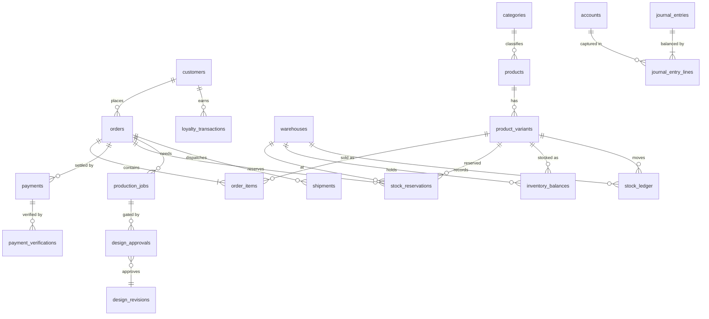
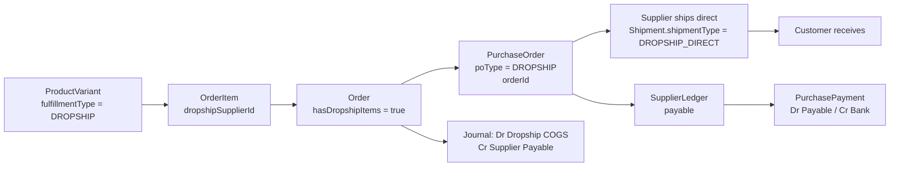

# bgd26.com — Entity Relationship Diagram

> Phase 1 deliverable. This diagram is generated from `prisma/schema.prisma`
> itself, so it cannot drift from the code. **90 tables, 234 foreign-key
> relationships (468 relation fields counting both sides), 81 enums.**

## How to read the diagram

| Symbol | Meaning |
| --- | --- |
| `||` | exactly one |
| `|o` | zero or one |
| `o{` | zero or many |
| `|{` | one or many |

- `PK` = primary key, `UK` = unique key (used by idempotency and lookup paths).
- Join tables `user_roles` and `role_permissions` use composite primary keys.
- Accounting and stock history are **append-only**: they have no `updatedAt`
  and are never hard-deleted.
- `journal_entries`, `stock_ledger` and `audit_logs` link to business documents
  through `referenceType` + `referenceId` (polymorphic) instead of 20 nullable
  foreign keys. This is intentional; the service layer validates the pair, and
  a DB trigger blocks edits to posted rows.

## Module map (13 domains / 90 tables)

| # | Domain | Tables |
| --- | --- | --- |
| 1 | Identity, RBAC & Audit | users, roles, permissions, user_roles, role_permissions, audit_logs |
| 2 | Customers & CRM | customers, customer_addresses, customer_mobile_history, customer_notes, customer_segments, loyalty_transactions |
| 3 | Products & Media | categories, brands, products, product_variants, bundle_items, media_assets, product_media |
| 4 | Inventory | warehouses, stores, inventory_balances, inventory_cost_history, stock_ledger, stock_reservations, stock_transfers, stock_transfer_items, stock_adjustments, stock_conflict_exceptions, inventory_reconciliation_runs |
| 5 | Purchasing & Dropshipping | suppliers, purchase_orders, purchase_items, goods_received_notes, goods_received_items, purchase_payments, purchase_returns |
| 6 | Orders & Promotions | orders, order_items, order_item_customizations, order_status_history, carts, cart_items, coupons, coupon_redemptions, delivery_zones |
| 7 | Payments & Refunds | payment_requests, payments, payment_transactions, payment_verifications, payment_settlements, payment_audit_logs, refunds, refund_items, refund_transactions |
| 8 | Production | production_jobs, production_job_items, customization_files, design_revisions, design_approvals, production_status_history |
| 9 | Shipping | couriers, shipments, shipment_tracking_events |
| 10 | Accounting | fiscal_periods, accounts, journal_entries, journal_entry_lines, customer_ledgers, supplier_ledgers, cash_accounts, bank_accounts, expenses |
| 11 | POS & Offline Sync | pos_devices, pos_shifts, pos_cash_movements, pos_sync_queue, pos_sync_logs |
| 12 | WhatsApp & AI | whatsapp_conversations, whatsapp_messages, whatsapp_templates, whatsapp_consents, ai_conversation_logs, ai_action_logs |
| 13 | Storefront engagement | product_reviews, review_media, wishlists, wishlist_items, newsletter_subscribers, site_pages |

## Critical commerce path

Only the tables that matter for the main money path are shown here. The full
90-table diagram is in Appendix A.



## Dropshipping path (first-class, no separate order system)

Dropship is a **fulfilment type**, not a second catalog. One customer order,
one payment, one invoice — the supplier is simply the party who ships.



Key rules:

1. **No stock ledger and no reservation** for a `DROPSHIP` variant. It behaves
   like `NON_STOCK` for inventory and like a normal sale for revenue/VAT.
2. A dropship PO is created when the order becomes `CONFIRMED`, but stock is
   never reserved. Cancelling before supplier dispatch cancels the PO.
3. `Shipment` records the supplier as the dispatcher (`supplierId`,
   `shipmentType = DROPSHIP_DIRECT`) so courier tracking and customer updates
   still work.
4. COGS is recognised on delivery: **Dr Dropship COGS / Cr Supplier Payable**.
   Paying the supplier is **Dr Supplier Payable / Cr Bank**.
5. Dropship returns bypass `inventory_balances`; `RefundItem.restock = false`
   and a supplier claim is recorded in `purchase_returns`.

## Cross-domain relationship notes

- **Orders → Accounting** is polymorphic: `journal_entries.referenceType =
  'ORDER'`, `referenceId = orders.id`. Same pattern for `'GRN'`, `'REFUND'`,
  `'EXPENSE'`, `'STOCK_ADJUSTMENT'`, `'PURCHASE_PAYMENT'`, `'DROPSHIP_PO'`.
- **Order → Inventory** happens only through `stock_reservations` (at
  `CONFIRMED`) and `stock_ledger` (at dispatch/handover). `AI_DRAFT` orders
  never create either row.
- **Production → Order** is `production_jobs.orderItemId`, and production
  status is independent of `orders.fulfillmentStatus`.
- **POS → Orders** is `orders.posShiftId` + `orders.clientTransactionUuid`
  (unique idempotency key). An offline conflict additionally writes
  `stock_conflict_exceptions` linked to the order, variant and device.
- **Customers are never merged destructively.** `customers.status = MERGED`
  keeps the old row so historical orders still resolve.

## Appendix A — complete ER diagram (all 90 tables)

> Rendered from the schema by `scripts/generate-er.py`-equivalent logic.
> If a viewer struggles with the size, open it in the Mermaid Live Editor.

```mermaid
erDiagram
  users {
    string id PK
    string email UK
    string fullName
    UserStatus status
    string managerPinHash
  }
  roles {
    string id PK
    string code UK
    string name
  }
  permissions {
    string id PK
    string code UK
    string resource
    string action
  }
  user_roles {
    string userId
    string roleId
    string assignedByUserId
  }
  role_permissions {
    string roleId
    string permissionId
  }
  audit_logs {
    string id PK
    string action
    string entityType
    string entityId
  }
  customers {
    string id PK
    string mobileNormalized UK
    string fullName
    CustomerType customerType
    int loyaltyPointsBalance
  }
  customer_addresses {
    string id PK
    string mobileNormalized
    string division
    string district
    string upazila
  }
  customer_mobile_history {
    string id PK
    string oldMobile
    string newMobile
  }
  customer_notes {
    string id PK
    string note
    bool isPinned
  }
  customer_segments {
    string id PK
    string code UK
    string name
  }
  loyalty_transactions {
    string id PK
    LoyaltyTxnType type
    int points
    int balanceAfter
  }
  categories {
    string id PK
    string name
    string slug UK
    decimal vatPercentage
  }
  brands {
    string id PK
    string name
    string slug UK
  }
  products {
    string id PK
    string sku UK
    string name
    ProductType productType
    ProductStatus status
  }
  product_variants {
    string id PK
    string sku UK
    string barcode UK
    decimal price
    FulfillmentType fulfillmentType
  }
  bundle_items {
    string id PK
    decimal quantity
    string bundleVariantId UK
  }
  media_assets {
    string id PK
    string storageKey UK
    string mimeType
    string sha256Checksum
    MediaVisibility visibility
  }
  product_media {
    string id PK
    MediaRole role UK
    int sortOrder
  }
  warehouses {
    string id PK
    string code UK
    string name
    WarehouseType type
    bool isDefault
  }
  stores {
    string id PK
    string code UK
    string name
    StoreType type
  }
  inventory_balances {
    string id PK
    decimal physicalQty
    decimal reservedQty
    decimal availableQty
    decimal avcoUnitCost
  }
  inventory_cost_history {
    string id PK
    decimal unitCostBefore
    decimal unitCostAfter
    decimal qtyIn
  }
  stock_ledger {
    string id PK
    StockMovementType movementType
    decimal quantity
    decimal unitCost
    decimal balanceAfterQty
  }
  stock_reservations {
    string id PK
    decimal quantity
    ReservationStatus status
    datetime expiresAt
  }
  stock_transfers {
    string id PK
    string transferNumber UK
    TransferStatus status
    decimal transferFee
  }
  stock_transfer_items {
    string id PK
    decimal quantity
    decimal sourceUnitCost
    decimal receivedQty
  }
  stock_adjustments {
    string id PK
    AdjustmentType adjustmentType
    decimal quantity
    AdjustmentStatus status
  }
  stock_conflict_exceptions {
    string id PK
    string clientTransactionUuid UK
    decimal requestedQty
    ConflictStatus status
  }
  inventory_reconciliation_runs {
    string id PK
    string runNumber UK
    ReconciliationStatus status
    int discrepanciesFound
  }
  suppliers {
    string id PK
    string code UK
    string name
    bool isDropshipVendor
    SupplierStatus status
  }
  purchase_orders {
    string id PK
    string poNumber UK
    PurchaseOrderType poType
    PurchaseOrderStatus status
    decimal grandTotal
  }
  purchase_items {
    string id PK
    decimal quantity
    decimal receivedQty
    decimal unitCost
  }
  goods_received_notes {
    string id PK
    string grnNumber UK
    GRNStatus status
    decimal totalValue
  }
  goods_received_items {
    string id PK
    decimal quantityReceived
    decimal unitCost
    GoodsCondition condition
  }
  purchase_payments {
    string id PK
    string paymentNumber UK
    decimal amount
    PaymentMethod method
  }
  purchase_returns {
    string id PK
    string returnNumber UK
    PurchaseReturnStatus status
    decimal totalValue
  }
  orders {
    string id PK
    string orderNumber UK
    OrderChannel channel
    OrderStatus status
    PaymentStatus paymentStatus
  }
  order_items {
    string id PK
    string skuSnapshot
    decimal quantity
    decimal unitPrice
    decimal lineTotal
  }
  order_item_customizations {
    string id PK
    CustomizationType type
    string textContent
    CustomizationFileStatus status
  }
  order_status_history {
    string id PK
    OrderStatusField field
    string fromValue
    string toValue
  }
  carts {
    string id PK
    string token UK
    CartStatus status
    decimal grandTotal
  }
  cart_items {
    string id PK
    decimal quantity
    decimal unitPrice
  }
  coupons {
    string id PK
    string code UK
    CouponType type
    decimal value
    bool isActive
  }
  coupon_redemptions {
    string id PK
    decimal discountAmount
    string couponId UK
  }
  delivery_zones {
    string id PK
    string division
    string district
    decimal charge
  }
  payment_requests {
    string id PK
    string requestNumber UK
    decimal amount
    PaymentRequestStatus status
  }
  payments {
    string id PK
    string paymentNumber UK
    decimal amount
    PaymentStatus status
    bool isOffline
  }
  payment_transactions {
    string id PK
    PaymentTxnType transactionType
    decimal amount
    PaymentTxnStatus status
    string providerTxnId UK
  }
  payment_verifications {
    string id PK
    VerificationType verificationType
    VerificationStatus status
    decimal verifiedAmount
  }
  payment_settlements {
    string id PK
    string settlementNumber UK
    decimal grossAmount
    decimal netAmount
    SettlementStatus status
  }
  payment_audit_logs {
    string id PK
    string action
    string oldStatus
    string newStatus
  }
  refunds {
    string id PK
    string refundNumber UK
    decimal totalAmount
    RefundStatus status
    bool isBundleReturn
  }
  refund_items {
    string id PK
    decimal quantity
    decimal lineTotal
    bool restock
    bool bundleComplete
  }
  refund_transactions {
    string id PK
    PaymentProvider provider
    decimal amount
    PaymentTxnStatus status
  }
  production_jobs {
    string id PK
    string jobNumber UK
    ProductionStatus status
    ProductionPriority priority
    datetime dueAt
  }
  production_job_items {
    string id PK
    decimal quantityRequired
    decimal quantityConsumed
  }
  customization_files {
    string id PK
    CustomizationFileType fileType
    CustomizationFileStatus status
    ActorType uploadedByType
  }
  design_revisions {
    string id PK
    int revisionNumber UK
    string description
  }
  design_approvals {
    string id PK
    string approvalToken UK
    DesignApprovalStatus status
    datetime approvedAt
  }
  production_status_history {
    string id PK
    ProductionStatus fromStatus
    ProductionStatus toStatus
  }
  couriers {
    string id PK
    string code UK
    CourierProvider provider
    bool supportsDropship
  }
  shipments {
    string id PK
    string shipmentNumber UK
    ShipmentType shipmentType
    ShipmentStatus status
    string trackingNumber
  }
  shipment_tracking_events {
    string id PK
    ShipmentStatus status
    string location
    datetime eventAt
  }
  fiscal_periods {
    string id PK
    string name
    datetime startDate UK
    datetime endDate UK
    FiscalPeriodStatus status
  }
  accounts {
    string id PK
    string code UK
    string name
    AccountType type
    NormalBalance normalBalance
  }
  journal_entries {
    string id PK
    string entryNumber UK
    datetime entryDate
    JournalEntryStatus status
    decimal totalDebit
  }
  journal_entry_lines {
    string id PK
    decimal debit
    decimal credit
    int lineOrder UK
  }
  customer_ledgers {
    string id PK
    LedgerEntryType type
    decimal debit
    decimal credit
    decimal balanceAfter
  }
  supplier_ledgers {
    string id PK
    LedgerEntryType type
    decimal debit
    decimal credit
    decimal balanceAfter
  }
  cash_accounts {
    string id PK
    string code UK
    string name
    decimal currentBalance
  }
  bank_accounts {
    string id PK
    string code UK
    string name
    string accountNumberMasked
    decimal currentBalance
  }
  expenses {
    string id PK
    string expenseNumber UK
    string category
    decimal amount
    ExpenseStatus status
  }
  pos_devices {
    string id PK
    string code UK
    string deviceFingerprint UK
    PosDeviceStatus status
  }
  pos_shifts {
    string id PK
    string shiftNumber UK
    PosShiftStatus status
    decimal openingFloat
    decimal cashVariance
  }
  pos_cash_movements {
    string id PK
    CashMovementType type
    decimal amount
  }
  pos_sync_queue {
    string id PK
    string clientTransactionUuid UK
    SyncQueueStatus status
    int attemptCount
  }
  pos_sync_logs {
    string id PK
    SyncOutcome outcome
    int httpStatus
    int durationMs
  }
  whatsapp_conversations {
    string id PK
    string phoneNumberNormalized
    WaConversationStatus status
    datetime windowExpiresAt
  }
  whatsapp_messages {
    string id PK
    WaDirection direction
    WaMessageType messageType
    WaMessageStatus status
    string waMessageId UK
  }
  whatsapp_templates {
    string id PK
    string name UK
    string language UK
    WaTemplateStatus status
  }
  whatsapp_consents {
    string id PK
    string phoneNumberNormalized UK
    ConsentStatus status
  }
  ai_conversation_logs {
    string id PK
    string conversationKey UK
    AiChannel channel
    AiConversationStatus status
  }
  ai_action_logs {
    string id PK
    string toolName
    AiActionStatus status
    AiRiskLevel riskLevel
  }
  product_reviews {
    string id PK
    int rating
    ReviewStatus status
    bool isVerifiedPurchase
    string title
  }
  review_media {
    string id PK
    int sortOrder
    string reviewId UK
  }
  wishlists {
    string id PK
    string name UK
    bool isDefault
    string shareToken UK
  }
  wishlist_items {
    string id PK
    string note
    string wishlistId UK
  }
  newsletter_subscribers {
    string id PK
    string email UK
    NewsletterStatus status
    string source
  }
  site_pages {
    string id PK
    string slug UK
    SitePageType pageType
    SitePageStatus status
    string title
  }

  users ||--o{ user_roles : "user"
  roles ||--o{ user_roles : "role"
  roles ||--o{ role_permissions : "role"
  permissions ||--o{ role_permissions : "permission"
  users |o--o{ audit_logs : "actor"
  users |o--o{ customers : "user"
  customer_segments |o--o{ customers : "segment"
  customers ||--o{ customer_addresses : "customer"
  customers ||--o{ customer_mobile_history : "customer"
  users |o--o{ customer_mobile_history : "changedBy"
  customers ||--o{ customer_notes : "customer"
  users |o--o{ customer_notes : "author"
  customers ||--o{ loyalty_transactions : "customer"
  orders |o--o{ loyalty_transactions : "order"
  users |o--o{ loyalty_transactions : "createdBy"
  categories |o--o{ categories : "parent"
  categories ||--o{ products : "category"
  brands |o--o{ products : "brand"
  users |o--o{ products : "createdBy"
  products ||--o{ product_variants : "product"
  suppliers |o--o{ product_variants : "dropshipSupplier"
  product_variants ||--o{ bundle_items : "bundleVariant"
  product_variants ||--o{ bundle_items : "componentVariant"
  users |o--o{ media_assets : "uploadedBy"
  customers |o--o{ media_assets : "customer"
  products ||--o{ product_media : "product"
  product_variants |o--o{ product_media : "variant"
  media_assets ||--o{ product_media : "mediaAsset"
  warehouses ||--o{ stores : "warehouse"
  users |o--o{ stores : "manager"
  product_variants ||--o{ inventory_balances : "variant"
  warehouses ||--o{ inventory_balances : "warehouse"
  product_variants ||--o{ inventory_cost_history : "variant"
  warehouses ||--o{ inventory_cost_history : "warehouse"
  users |o--o{ inventory_cost_history : "createdBy"
  product_variants ||--o{ stock_ledger : "variant"
  warehouses ||--o{ stock_ledger : "warehouse"
  stores |o--o{ stock_ledger : "store"
  users |o--o{ stock_ledger : "createdBy"
  product_variants ||--o{ stock_reservations : "variant"
  warehouses ||--o{ stock_reservations : "warehouse"
  orders ||--o{ stock_reservations : "order"
  order_items |o--o{ stock_reservations : "orderItem"
  warehouses ||--o{ stock_transfers : "fromWarehouse"
  warehouses ||--o{ stock_transfers : "toWarehouse"
  accounts |o--o{ stock_transfers : "feeExpenseAccount"
  users |o--o{ stock_transfers : "requestedBy"
  users |o--o{ stock_transfers : "approvedBy"
  stock_transfers ||--o{ stock_transfer_items : "transfer"
  product_variants ||--o{ stock_transfer_items : "variant"
  warehouses ||--o{ stock_adjustments : "warehouse"
  product_variants ||--o{ stock_adjustments : "variant"
  users |o--o{ stock_adjustments : "approvedBy"
  users |o--o{ stock_adjustments : "createdBy"
  journal_entries |o--o{ stock_adjustments : "journalEntry"
  orders ||--o{ stock_conflict_exceptions : "order"
  order_items |o--o{ stock_conflict_exceptions : "orderItem"
  product_variants ||--o{ stock_conflict_exceptions : "variant"
  warehouses ||--o{ stock_conflict_exceptions : "warehouse"
  pos_devices |o--o{ stock_conflict_exceptions : "posDevice"
  users |o--o{ stock_conflict_exceptions : "resolvedBy"
  warehouses ||--o{ inventory_reconciliation_runs : "warehouse"
  users |o--o{ inventory_reconciliation_runs : "runBy"
  accounts |o--o{ suppliers : "payableAccount"
  suppliers ||--o{ purchase_orders : "supplier"
  warehouses |o--o{ purchase_orders : "warehouse"
  orders |o--o{ purchase_orders : "order"
  users |o--o{ purchase_orders : "approvedBy"
  purchase_orders ||--o{ purchase_items : "purchaseOrder"
  product_variants |o--o{ purchase_items : "variant"
  order_items |o--o{ purchase_items : "orderItem"
  purchase_orders ||--o{ goods_received_notes : "purchaseOrder"
  warehouses ||--o{ goods_received_notes : "warehouse"
  suppliers ||--o{ goods_received_notes : "supplier"
  users |o--o{ goods_received_notes : "receivedBy"
  journal_entries |o--o{ goods_received_notes : "journalEntry"
  goods_received_notes ||--o{ goods_received_items : "grn"
  purchase_items |o--o{ goods_received_items : "purchaseItem"
  product_variants ||--o{ goods_received_items : "variant"
  purchase_orders |o--o{ purchase_payments : "purchaseOrder"
  suppliers ||--o{ purchase_payments : "supplier"
  users |o--o{ purchase_payments : "recordedBy"
  journal_entries |o--o{ purchase_payments : "journalEntry"
  purchase_orders ||--o{ purchase_returns : "purchaseOrder"
  goods_received_notes |o--o{ purchase_returns : "grn"
  suppliers ||--o{ purchase_returns : "supplier"
  warehouses ||--o{ purchase_returns : "warehouse"
  journal_entries |o--o{ purchase_returns : "journalEntry"
  users |o--o{ purchase_returns : "createdBy"
  customers ||--o{ orders : "customer"
  stores |o--o{ orders : "store"
  warehouses |o--o{ orders : "warehouse"
  pos_devices |o--o{ orders : "posDevice"
  pos_shifts |o--o{ orders : "posShift"
  users |o--o{ orders : "cashier"
  users |o--o{ orders : "createdBy"
  users |o--o{ orders : "walkInApprover"
  coupons |o--o{ orders : "coupon"
  delivery_zones |o--o{ orders : "deliveryZone"
  orders ||--o{ order_items : "order"
  product_variants |o--o{ order_items : "variant"
  products |o--o{ order_items : "product"
  suppliers |o--o{ order_items : "dropshipSupplier"
  warehouses |o--o{ order_items : "warehouse"
  order_items ||--o{ order_item_customizations : "orderItem"
  media_assets |o--o{ order_item_customizations : "fileAsset"
  orders ||--o{ order_status_history : "order"
  users |o--o{ order_status_history : "actor"
  customers |o--o{ carts : "customer"
  coupons |o--o{ carts : "coupon"
  carts ||--o{ cart_items : "cart"
  product_variants ||--o{ cart_items : "variant"
  users |o--o{ coupons : "createdBy"
  coupons ||--o{ coupon_redemptions : "coupon"
  customers |o--o{ coupon_redemptions : "customer"
  orders ||--o{ coupon_redemptions : "order"
  orders ||--o{ payment_requests : "order"
  payment_requests |o--o{ payments : "paymentRequest"
  orders ||--o{ payments : "order"
  customers |o--o{ payments : "customer"
  pos_shifts |o--o{ payments : "posShift"
  users |o--o{ payments : "verifiedBy"
  users |o--o{ payments : "createdBy"
  payments ||--o{ payment_transactions : "payment"
  payments ||--o{ payment_verifications : "payment"
  users |o--o{ payment_verifications : "verifiedBy"
  bank_accounts |o--o{ payment_settlements : "bankAccount"
  payments ||--o{ payment_audit_logs : "payment"
  users |o--o{ payment_audit_logs : "actor"
  orders ||--o{ refunds : "order"
  payments |o--o{ refunds : "payment"
  customers ||--o{ refunds : "customer"
  users |o--o{ refunds : "requestedBy"
  users |o--o{ refunds : "approvedBy"
  journal_entries |o--o{ refunds : "journalEntry"
  refunds ||--o{ refund_items : "refund"
  order_items ||--o{ refund_items : "orderItem"
  warehouses |o--o{ refund_items : "restockWarehouse"
  refunds ||--o{ refund_transactions : "refund"
  orders ||--o{ production_jobs : "order"
  order_items ||--o{ production_jobs : "orderItem"
  stores |o--o{ production_jobs : "store"
  warehouses ||--o{ production_jobs : "warehouse"
  users |o--o{ production_jobs : "assignedTo"
  users |o--o{ production_jobs : "createdBy"
  production_jobs ||--o{ production_job_items : "job"
  product_variants ||--o{ production_job_items : "variant"
  order_items ||--o{ customization_files : "orderItem"
  production_jobs |o--o{ customization_files : "productionJob"
  media_assets |o--o{ customization_files : "mediaAsset"
  users |o--o{ customization_files : "uploadedBy"
  customers |o--o{ customization_files : "customer"
  production_jobs ||--o{ design_revisions : "productionJob"
  media_assets |o--o{ design_revisions : "mediaAsset"
  users |o--o{ design_revisions : "createdBy"
  production_jobs ||--o{ design_approvals : "productionJob"
  design_revisions ||--o{ design_approvals : "designRevision"
  customers |o--o{ design_approvals : "approvedByCustomer"
  production_jobs ||--o{ production_status_history : "productionJob"
  users |o--o{ production_status_history : "changedBy"
  orders ||--o{ shipments : "order"
  couriers |o--o{ shipments : "courier"
  warehouses |o--o{ shipments : "warehouse"
  suppliers |o--o{ shipments : "supplier"
  users |o--o{ shipments : "createdBy"
  shipments ||--o{ shipment_tracking_events : "shipment"
  users |o--o{ fiscal_periods : "lockedBy"
  accounts |o--o{ accounts : "parent"
  fiscal_periods ||--o{ journal_entries : "fiscalPeriod"
  users |o--o{ journal_entries : "postedBy"
  users |o--o{ journal_entries : "createdBy"
  journal_entries |o--o| journal_entries : "reversalOf"
  journal_entries ||--o{ journal_entry_lines : "journalEntry"
  accounts ||--o{ journal_entry_lines : "account"
  customers |o--o{ journal_entry_lines : "customer"
  suppliers |o--o{ journal_entry_lines : "supplier"
  customers ||--o{ customer_ledgers : "customer"
  orders |o--o{ customer_ledgers : "order"
  journal_entries |o--o{ customer_ledgers : "journalEntry"
  suppliers ||--o{ supplier_ledgers : "supplier"
  purchase_orders |o--o{ supplier_ledgers : "purchaseOrder"
  orders |o--o{ supplier_ledgers : "order"
  journal_entries |o--o{ supplier_ledgers : "journalEntry"
  stores |o--o{ cash_accounts : "store"
  warehouses |o--o{ cash_accounts : "warehouse"
  accounts ||--o{ cash_accounts : "account"
  accounts ||--o{ bank_accounts : "account"
  accounts ||--o{ expenses : "account"
  cash_accounts |o--o{ expenses : "cashAccount"
  bank_accounts |o--o{ expenses : "bankAccount"
  suppliers |o--o{ expenses : "supplier"
  journal_entries |o--o{ expenses : "journalEntry"
  users |o--o{ expenses : "createdBy"
  media_assets |o--o{ expenses : "receiptAsset"
  stores ||--o{ pos_devices : "store"
  warehouses ||--o{ pos_devices : "warehouse"
  users |o--o{ pos_devices : "registeredBy"
  pos_devices ||--o{ pos_shifts : "device"
  stores ||--o{ pos_shifts : "store"
  users ||--o{ pos_shifts : "cashier"
  pos_shifts ||--o{ pos_cash_movements : "shift"
  users ||--o{ pos_cash_movements : "performedBy"
  users |o--o{ pos_cash_movements : "approvedBy"
  pos_devices ||--o{ pos_sync_queue : "device"
  pos_shifts |o--o{ pos_sync_queue : "shift"
  orders |o--o{ pos_sync_queue : "serverOrder"
  pos_sync_queue |o--o{ pos_sync_logs : "syncQueue"
  pos_devices ||--o{ pos_sync_logs : "device"
  orders |o--o{ pos_sync_logs : "serverOrder"
  customers |o--o{ whatsapp_conversations : "customer"
  users |o--o{ whatsapp_conversations : "assignedTo"
  whatsapp_conversations ||--o{ whatsapp_messages : "conversation"
  media_assets |o--o{ whatsapp_messages : "mediaAsset"
  whatsapp_templates |o--o{ whatsapp_messages : "template"
  users |o--o{ whatsapp_messages : "sentBy"
  customers ||--o{ whatsapp_consents : "customer"
  users |o--o{ ai_conversation_logs : "user"
  customers |o--o{ ai_conversation_logs : "customer"
  ai_conversation_logs |o--o{ ai_action_logs : "conversationLog"
  orders |o--o{ ai_action_logs : "relatedOrder"
  users |o--o{ ai_action_logs : "actor"
  products ||--o{ product_reviews : "product"
  product_variants |o--o{ product_reviews : "variant"
  customers ||--o{ product_reviews : "customer"
  order_items |o--o| product_reviews : "orderItem"
  users |o--o{ product_reviews : "moderatedBy"
  product_reviews ||--o{ review_media : "review"
  media_assets ||--o{ review_media : "mediaAsset"
  customers ||--o{ wishlists : "customer"
  wishlists ||--o{ wishlist_items : "wishlist"
  product_variants ||--o{ wishlist_items : "variant"
  customers |o--o{ newsletter_subscribers : "customer"
  media_assets |o--o{ site_pages : "ogImage"
  users |o--o{ site_pages : "author"
```

---

### Generation & maintenance

This appendix is generated from `prisma/schema.prisma` (parsed directly — every
`@relation(fields: [...])` becomes one edge). When the schema changes:

1. Regenerate the body (Phase 2 adds `scripts/generate-er.ts`; the Phase 1
   parser was a one-off Python script).
2. Run `python3 scripts/check-schema.py` before committing.
3. Never hand-edit the appendix; edit the schema and regenerate.

**Phase 1 status:** 90 tables · 234 FK relationships · 81 enums · 0 structural
errors in the offline validator.
